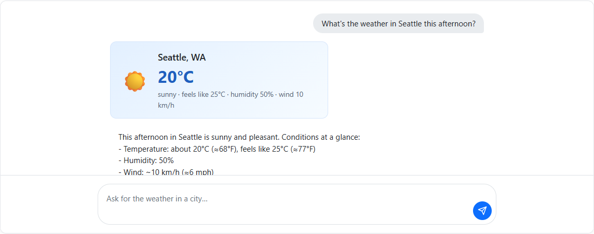
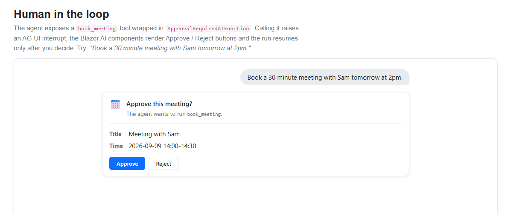
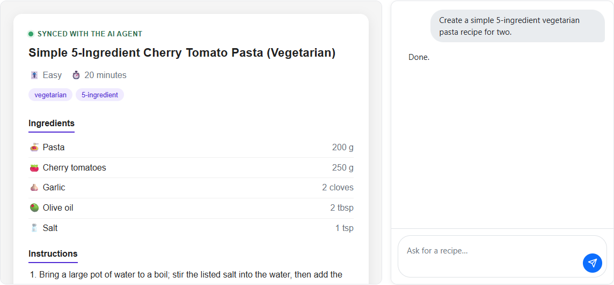
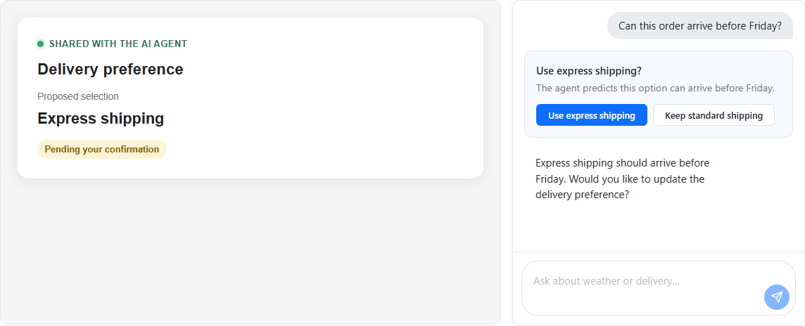

# ASP.NET Core Blazor AI components for agentic user interfaces

<!-- UPDATE 12.0 - Replace preview notice with not-latest-version.md and
                   remove the prerelease/experimental IMPORTANT NOTE below -->

<!-- UPDATE 11.0 - API XREF cross-links -->

[!INCLUDE[](~/includes/preview-notice.md)]

Modern AI apps increasingly provide rich interactions with agents. A complete agentic user interface may need to stream ongoing work, visualize agent reasoning and progress, request approval before tools act, accept multimodal input, and synchronize state between the app and the agent. The Blazor AI components are designed to provide building blocks for creating these experiences using Blazor's component model.

The [`Microsoft.AspNetCore.Components.AI` NuGet package](https://www.nuget.org/packages/Microsoft.AspNetCore.Components.AI) includes a set of Blazor AI components for streaming chat, rich-text and tool rendering, human approval flows, and typed, shared, and predictive UI state.

> [!IMPORTANT]
> The `Microsoft.AspNetCore.Components.AI` package is a prerelease, experimental package throughout .NET 11. Experimental features are provided for the purpose of exploring feature viability and may not ship in a stable version.

## Packages

Add the following package references to the Blazor app:

* [`Microsoft.AspNetCore.Components.AI`](https://www.nuget.org/packages/Microsoft.AspNetCore.Components.AI)
* [`AGUI.Client`](https://www.nuget.org/packages/AGUI.Client)

[!INCLUDE[](~/includes/package-reference.md)]

Basic chat and the Components.AI block model work with any `IChatClient`. The `AGUI.Client` package provides API for connecting the Blazor app to a remote agent over the [Agent User Interaction Protocol (AG-UI)](https://ag-ui.com).

`AGUI.Client` includes a transitive reference to the [`AGUI.Abstractions` NuGet package](https://www.nuget.org/packages/AGUI.Abstractions), which provides the AG-UI event types used in examples later in this article.

## Get started

Register an [`AGUIChatClient`](https://docs.ag-ui.com/sdk/dotnet/client/chat-client) as the app's `IChatClient`:

```csharp
using AGUI.Client;
using Microsoft.Extensions.AI;

builder.Services.AddHttpClient("Agent", client =>
{
    client.Timeout = Timeout.InfiniteTimeSpan;
});

builder.Services.AddScoped<IChatClient>(services =>
{
    var httpClient = services.GetRequiredService<IHttpClientFactory>()
        .CreateClient("Agent");

    return new AGUIChatClient(
        new AGUIChatClientOptions(httpClient, "https://api.example.com/agent"));
});
```

`AGUIChatClient` streams AG-UI events as `ChatResponseUpdate` values. The Blazor AI components render the conversational content from these updates, while apps can use the additional AG-UI event information to build richer agentic interactions. While basic chat functionality is supported with any `IChatClient`, AG-UI is required when a remote server and the Blazor client must exchange frontend tool declarations, backend tool events, approval interrupts, shared-state events, or AG-UI conversation identifiers.

Microsoft Agent Framework (MAF) can expose an `AIAgent` through an ASP.NET Core AG-UI endpoint. For the server-side setup, see [AG-UI integration with Agent Framework](/agent-framework/integrations/by-component/ui/ag-ui/) and its [.NET getting-started guide](/agent-framework/integrations/by-component/ui/ag-ui/getting-started).

## Build a basic streaming conversation

The first step in an agentic UI is often a basic conversation that streams responses and retains message history across turns. Chat support is provider- and protocol-neutral. Apps supply an `IChatClient` from `Microsoft.Extensions.AI`, and `UIAgent` converts its streaming responses into observable content blocks.

`ChatPage` is a complete chat shell that combines three lower-level components:

* `AgentBoundary` creates and cascades the conversation state.
* `MessageList` renders each turn as it streams and provides default typing, error, and retry UI.
* `MessageInput` sends messages from a text area and disables input while a response is streaming.

The following component creates a `UIAgent` over an app-provided `IChatClient` and renders the conversation with `ChatPage`:

```razor
@rendermode InteractiveServer
@using Microsoft.AspNetCore.Components.AI
@using Microsoft.Extensions.AI
@implements IDisposable
@inject IChatClient ChatClient

<ChatPage Agent="agent" Placeholder="Type a message...">
    <WelcomeContent>
        <p>Ask the agent a question.</p>
    </WelcomeContent>
</ChatPage>

@code {
    private UIAgent agent = default!;

    protected override void OnInitialized()
    {
        agent = new UIAgent(ChatClient);
    }

    public void Dispose() => agent.Dispose();
}
```

`Placeholder` sets the hint shown in the empty message input. `WelcomeContent` supplies the content shown before the first message is sent.

Include the component styles in the `App` component (`Components/App.razor`):

```razor
<link rel="stylesheet" href="@Assets["_content/Microsoft.AspNetCore.Components.AI/ai-chat.css"]" />
```


## Render content blocks

An `IChatClient` streams model-facing content, such as `TextContent`, `RichTextContent`, and `FunctionCallContent`, in `ChatResponseUpdate` values. `UIAgent` maps this response content into UI-facing `ContentBlock` objects that retain rendering state and can update in place while the response streams. For example, both plain-text fragments and structured rich-text snapshots map to a `RichContentBlock`.

The built-in block types include:

* `RichContentBlock` for streamed text and structured rich content.
* `FunctionInvocationContentBlock` for a server function call and its eventual result.
* `UIActionBlock` for a function that runs in the Blazor app.
* `FunctionApprovalBlock` for a function call that is waiting for user approval.
* `ActivityContentBlock` for application-defined progress that updates in place.

`ChatPage` and `MessageList` include default rendering for `RichContentBlock` and `FunctionApprovalBlock`. Add a `BlockRenderer<TBlock>` to `ChatPage.MessageListContent` to replace this default rendering or render another block type. Its child content receives the matching block as `context`, including its current properties as they change during streaming.

The following example replaces the default rendering for conversational content:

```razor
<ChatPage Agent="agent">
    <MessageListContent>
        <BlockRenderer TBlock="RichContentBlock" Context="block">
            <div class="agent-response">@block.RawText</div>
        </BlockRenderer>
    </MessageListContent>
</ChatPage>
```

Use the renderer's `When` predicate to only handle selected blocks of a type. If multiple renderers match, the most recently registered renderer takes precedence. Apps can also define custom `ContentBlock` types and map response content to them with a `ContentBlockHandler<TState>`.

## Render structured rich text

Rich-text support permits an agent to return a structured presentation model instead of plain text. `RichTextContent` is response content that contains both plain text and `RichTextNode` values for headings, paragraphs, emphasis, links, lists, code blocks, tables, and other presentation elements. `UIAgent` maps it to the same `RichContentBlock` used for plain `TextContent` but uses the supplied node tree instead of creating simple paragraphs.

Apps can produce `RichTextContent` directly or use `IChatClient` middleware to transform streamed `TextContent`, such as by parsing markdown into `RichTextNode` values. The package doesn't require or include a particular markdown implementation. Each `RichTextContent` is a complete snapshot, so it atomically replaces the previous content for the same message as streaming progresses. `ChatPage` and `MessageList` then render the structured content without requiring a custom `BlockRenderer`.

## Render server tool calls

An agent can call a tool that runs on its server while the Blazor app renders the operation using app-specific UI. For example, the agent can call a weather tool, and the app can show the requested location immediately, followed by a weather card when the server returns the result.

Server tool calls become `FunctionInvocationContentBlock` instances, which pair the `FunctionCallContent` with its eventual `FunctionResultContent` and expose the tool name, arguments, and completion state.

The package's source generator creates a strongly typed block handler from a class annotated with `ToolBlock`, `ToolParameter`, and `ToolResult`:

```csharp
[ToolBlock("get_weather")]
public partial class WeatherToolBlock : FunctionInvocationContentBlock
{
    [ToolParameter(Name = "location")]
    public string? Location { get; set; }

    [ToolResult]
    public WeatherInfo? Weather { get; set; }
}
```

Register the generated handlers when constructing the `UIAgent`:

```csharp
var agent = new UIAgent(
    chatClient,
    options => options.AddGeneratedToolBlocks());
```

Render the generated block in `MessageListContent`:

```razor
<ChatPage Agent="agent">
    <MessageListContent>
        <BlockRenderer TBlock="WeatherToolBlock">
            @if (context.HasResult)
            {
                <p>@context.Location: @context.Weather?.Temperature&deg;C</p>
            }
            else
            {
                <p>Checking the weather for @context.Location...</p>
            }
        </BlockRenderer>
    </MessageListContent>
</ChatPage>
```

As the call arguments stream, the generated handler updates `Location` while `HasResult` remains `false`. When the result arrives, it populates `Weather`, sets `HasResult` to `true`, and rerenders the same block as the completed weather card.



When MAF hosts the remote agent, backend tools use its normal tool pipeline and AG-UI transports the call and result to the client. For more information, see [Backend tool rendering with AG-UI](/agent-framework/integrations/by-component/ui/ag-ui/backend-tool-rendering).

## Run frontend tools

Frontend tools run in the client app rather than on the agent server. For example, a Blazor app can expose a tool that changes UI state, reads a local preference, or asks the user for input. Create the tool with `AIFunctionFactory` from `Microsoft.Extensions.AI`, then register it with `UIAgentOptions.RegisterUIAction`.

`RegisterUIAction` advertises the `AIFunction` to the agent. When the agent requests it, `UIAgent` creates a `UIActionBlock` instead of executing the function immediately:

```csharp
var setAccentColor = AIFunctionFactory.Create(
    async (string color) =>
    {
        await InvokeAsync(() =>
        {
            accentColor = color;
            StateHasChanged();
        });
        return $"Changed the accent color to {color}.";
    },
    name: "set_accent_color");

var agent = new UIAgent(
    chatClient,
    options => options.RegisterUIAction(setAccentColor));
```

Place a `BlockRenderer<UIActionBlock>` in `MessageListContent` to handle the function call requested by the agent. For example, the renderer can use a component that automatically invokes the function and displays its progress:

```razor
<ChatPage Agent="agent">
    <MessageListContent>
        <BlockRenderer TBlock="UIActionBlock"
                       When='@(action => action.ToolName == "set_accent_color")'
                       Context="action">
            <AutoInvokeAction Action="action" />
        </BlockRenderer>
    </MessageListContent>
</ChatPage>
```

The `AutoInvokeAction` component calls `InvokeAsync` when it receives the block:

```razor
@if (Action.IsComplete)
{
    <span>Accent color updated</span>
}
else
{
    <span>Updating accent color...</span>
}

@code {
    [Parameter, EditorRequired]
    public UIActionBlock Action { get; set; } = default!;

    protected override async Task OnInitializedAsync()
    {
        if (!Action.IsComplete)
        {
            await Action.InvokeAsync();
        }
    }
}
```

Calling `InvokeAsync` executes the registered function with the arguments supplied by the agent. The function runs wherever the Blazor UI runs: in the server-side circuit for Blazor Server or in the browser for WebAssembly. When the function completes, `UIAgent` sends its result back to the agent and continues the conversation. Use the renderer's `When` predicate to provide different handling for each `action.ToolName`. A renderer can invoke the action automatically, as shown here, or present UI that collects input or confirmation first.

## Require approval before tools run

An app can require the user to approve a consequential tool call, such as scheduling a meeting, before the agent proceeds. Tool approval requests become `FunctionApprovalBlock` instances. The conversation pauses until the UI calls `Approve` or `Reject`:

```razor
<ChatPage Agent="agent">
    <MessageListContent>
        <BlockRenderer TBlock="FunctionApprovalBlock" Context="approval">
            <p>Allow <code>@approval.ToolName</code> to run?</p>
            <button @onclick="approval.Approve">Approve</button>
            <button @onclick="() => approval.Reject()">Reject</button>
        </BlockRenderer>
    </MessageListContent>
</ChatPage>
```



For a MAF agent, the server decides which functions require approval, and AG-UI transports the request and decision. For more information, see [Human-in-the-loop with AG-UI](/agent-framework/integrations/by-component/ui/ag-ui/human-in-the-loop).

## Display activities

An activity is an app-defined progress item that updates in place while an agent performs longer-running work. For example, a research agent can show that it's searching sources, comparing results, and completing the research without adding a separate message for every update.

`ActivityHandler<TBlock>` is a protocol-neutral extension point that maps provider- or app-specific progress updates into a mutable `ActivityContentBlock`. `TryCreateBlock` initializes and emits the block for the first matching update. `TryUpdateBlock` mutates the same block as later updates arrive and indicates when the activity is complete. Register the handler with `UIAgentOptions.AddBlockHandler`, then provide a `BlockRenderer` for the app-specific block. Activities don't have a default visual representation.

AG-UI's `ACTIVITY_SNAPSHOT` and `ACTIVITY_DELTA` events are one possible source of these updates. `AGUIChatClient` exposes the original event through `ChatResponseUpdate.RawRepresentation`. For example, an app can handle replacing snapshots whose payload includes an app-defined `complete` property:

```csharp
using System.Text.Json;
using Microsoft.AspNetCore.Components.AI;
using AGUI.Abstractions;

public sealed class ResearchActivityBlock : ActivityContentBlock
{
    public string ActivityMessageId { get; set; } = "";
}

public sealed class ResearchActivityHandler
    : ActivityHandler<ResearchActivityBlock>
{
    protected override bool TryCreateBlock(
        BlockMappingContext context,
        ResearchActivityBlock state)
        => TryApplySnapshot(context, state, out _);

    protected override bool TryUpdateBlock(
        BlockMappingContext context,
        ResearchActivityBlock state,
        out bool isCompleted)
        => TryApplySnapshot(context, state, out isCompleted);

    private static bool TryApplySnapshot(
        BlockMappingContext context,
        ResearchActivityBlock state,
        out bool isCompleted)
    {
        isCompleted = false;

        if (context.Update.RawRepresentation is not ActivitySnapshotEvent snapshot ||
            (state.ActivityMessageId.Length > 0 &&
             (state.ActivityMessageId != snapshot.MessageId ||
              snapshot.Replace == false)))
        {
            return false;
        }

        state.ActivityMessageId = snapshot.MessageId;
        state.ActivityType = snapshot.ActivityType;
        state.Content = snapshot.Content;
        isCompleted =
            snapshot.Content.ValueKind == JsonValueKind.Object &&
            snapshot.Content.TryGetProperty("complete", out var complete) &&
            complete.ValueKind == JsonValueKind.True;
        context.MarkUpdateHandled();
        return true;
    }
}
```

The handler stores the AG-UI message ID on the block to correlate later snapshots. Apps that consume `ActivityDeltaEvent` instead apply its RFC 6902 JSON Patch operations to the current `Content` before returning from `TryUpdateBlock`. The app defines the activity payload and completion semantics; Components.AI doesn't include an AG-UI-specific activity handler or JSON Patch implementation.

## Shared state

Agentic UIs often show a shared workspace alongside the conversation, such as a recipe, document, form, or plan that the agent can update. `UIAgent<TState>` exposes this data as typed, observable UI state separately from conversational content.

The app configures a state mapper for the `ChatResponseUpdate` values produced by its `IChatClient`. In an AG-UI integration, the agent server explicitly maps selected tool results to `STATE_SNAPSHOT` or `STATE_DELTA` events. `AGUIChatClient` then exposes those events through `ChatResponseUpdate.RawRepresentation`, where the Blazor app can deserialize them and call `SetState`:

```csharp
using System.Text.Json;
using AGUI.Abstractions;
using Microsoft.AspNetCore.Components.AI;

var agent = new UIAgent<RecipeState>(chatClient, options =>
{
    options.StateMapper = context =>
    {
        if (context.Update.RawRepresentation is StateSnapshotEvent snapshot &&
            snapshot.Snapshot.Deserialize<RecipeState>(
                JsonSerializerOptions.Web) is { } state)
        {
            context.SetState(state);
        }
    };
});
```

Read the current value from `agent.State.Value` and subscribe to `agent.State.OnChanged` when the surrounding component needs to rerender. State mappers can also handle app-specific `AIContent` from other `IChatClient` implementations.



For the corresponding MAF server configuration, including mapping tool results to state snapshots and deltas, see [State management with AG-UI](/agent-framework/integrations/by-component/ui/ag-ui/state-management).

## Show predictive UI state

Predictive state permits an app to render an agent's proposed state change while the model is still generating it without replacing the committed state. For example, as an agent generates the complete contents of an edited document in a tool argument, the UI can progressively display the proposed document and a diff. When generation finishes, the user can accept the completed proposal or reject it and restore the committed document.

An AG-UI server integration can map streamed arguments for a state-writing tool to provisional state events. The completed tool-call arguments are the authoritative proposal. When creating the `UIAgent<TState>`, configure its state mapper to deserialize those events and call `SetPredictiveState`. `AgentState<TState>` then retains the prior committed value for rollback:

```csharp
using System.Text.Json;
using AGUI.Abstractions;
using Microsoft.AspNetCore.Components.AI;

var agent = new UIAgent<DocumentState>(chatClient, options =>
{
    options.StateMapper = context =>
    {
        if (context.Update.RawRepresentation is StateSnapshotEvent snapshot &&
            snapshot.Snapshot.Deserialize<DocumentState>(
                JsonSerializerOptions.Web) is { } predictedState)
        {
            context.SetPredictiveState(predictedState);
        }
    };

    options.RegisterUIAction(AIFunctionFactory.Create(
        ConfirmChanges,
        name: "confirm_changes",
        description: "Confirm the proposed document changes."));
});
```

The example also registers a `confirm_changes` frontend action. When the action appears, a custom block renderer displays the accept and reject controls. The renderer adds the user's choice as the `accepted` argument and calls `UIActionBlock.InvokeAsync`, which runs the registered callback:

```csharp
private string ConfirmChanges(bool accepted)
{
    if (accepted)
    {
        agent.State.AcceptPredictiveState();
    }
    else
    {
        agent.State.RejectPredictiveState();
    }

    return accepted
        ? "The user accepted the changes."
        : "The user rejected the changes.";
}
```

The provisional value is immediately available from `agent.State.Value`, and `HasPendingPredictiveState` indicates that it isn't committed. The callback commits the completed proposal or restores the baseline, and its return value reports the decision to the agent in a follow-up run. If generation fails, is canceled, or ends without a decision, the provisional value is automatically rolled back. The server-side extraction and mapping of streamed tool arguments must be configured explicitly; see [State management with AG-UI](/agent-framework/integrations/by-component/ui/ag-ui/state-management).



## Persist and restore conversations

An `IConversationThread` stores completed turns so a UI can rebuild its conversation after the component or app restarts. A thread can also retain protocol metadata, such as the `threadId` and previous `runId` used to continue a server-owned AG-UI conversation.

Pass the thread when constructing `UIAgent`, then call `UIAgent.RestoreAsync` or `AgentContext.RestoreAsync` to explicitly replay the stored updates into content blocks and typed state:

```csharp
var agent = new UIAgent(
    chatClient,
    options => options.Thread = conversationThread);

var restoredBlocks = await agent.RestoreAsync();
```

Passing a thread to `UIAgent` enables new completed turns to be persisted but doesn't automatically restore earlier turns. For MAF-hosted AG-UI agents, see [AG-UI conversation continuity](/agent-framework/integrations/by-component/ui/ag-ui/getting-started#conversation-continuity).
