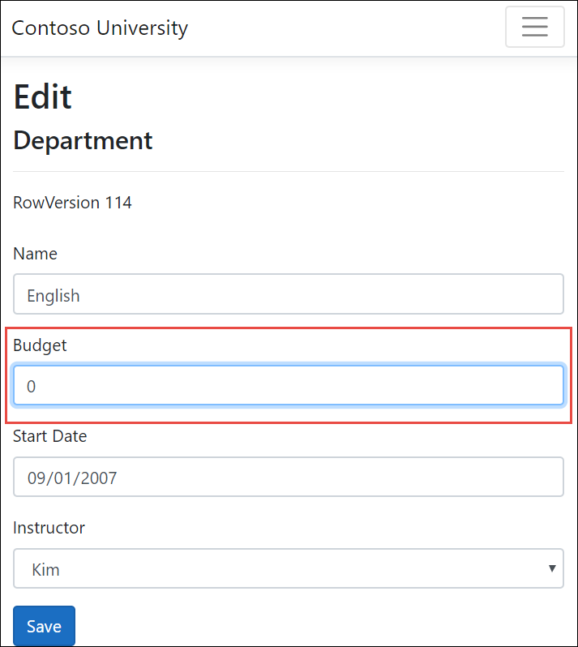
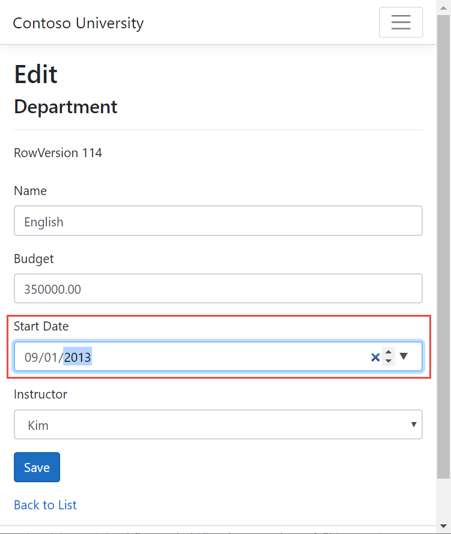
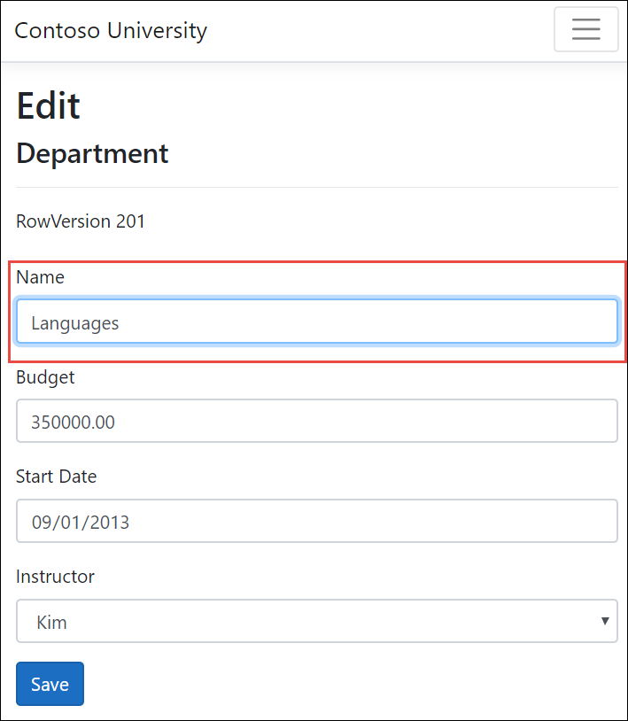
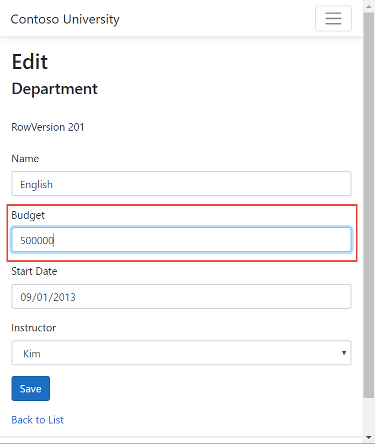
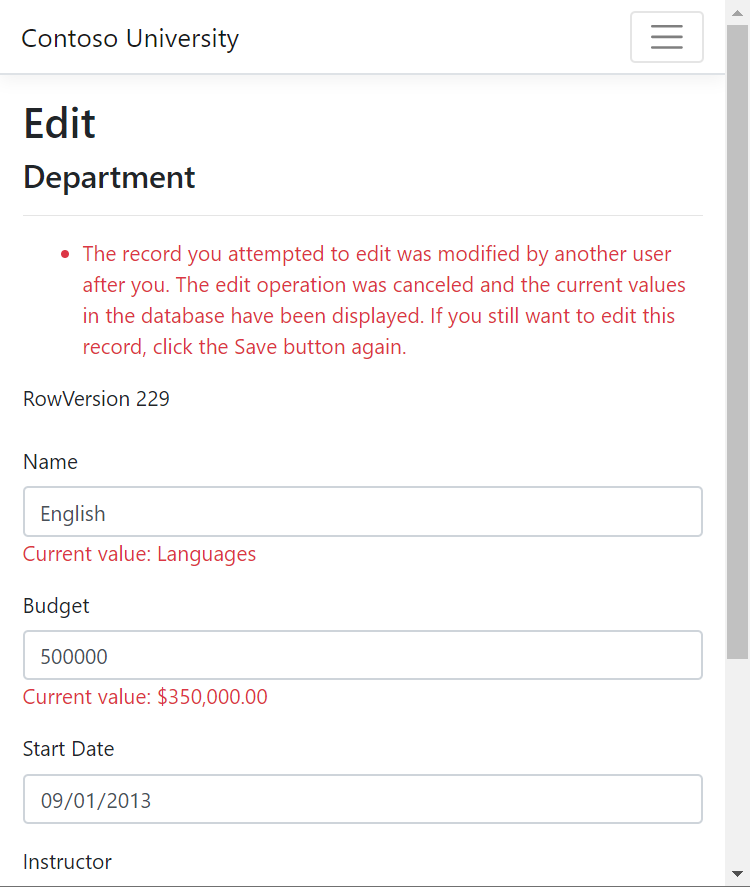

# Part 8, Razor Pages with EF Core in ASP.NET Core - Concurrency

[Tom Dykstra](https://github.com/tdykstra), and [Jon P Smith](https://twitter.com/thereformedprog)

[!INCLUDE [about the series](../../includes/RP-EF/intro.md)]

This tutorial shows how to handle conflicts when multiple users update an entity concurrently.

## Concurrency conflicts

A concurrency conflict occurs when:

* A user navigates to the edit page for an entity.
* Another user updates the same entity before the first user's change is written to the database.

If concurrency detection isn't enabled, whoever updates the database last overwrites the other user's changes. If this risk is acceptable, the cost of programming for concurrency might outweigh the benefit.

### Pessimistic concurrency

One way to prevent concurrency conflicts is to use database locks. This is called pessimistic concurrency. Before the app reads a database row that it intends to update, it requests a lock. Once a row is locked for update access, no other users are allowed to lock the row until the first lock is released.

Managing locks has disadvantages. It can be complex to program and can cause performance problems as the number of users increases. Entity Framework Core provides no built-in support for pessimistic concurrency.

### Optimistic concurrency

Optimistic concurrency allows concurrency conflicts to happen, and then reacts appropriately when they do. For example, Jane visits the Department edit page and changes the budget for the English department from $350,000.00 to $0.00.



Before Jane clicks **Save**, John visits the same page and changes the Start Date field from 9/1/2007 to 9/1/2013.



Jane clicks **Save** first and sees her change take effect, since the browser displays the Index page with zero as the Budget amount.

John clicks **Save** on an Edit page that still shows a budget of $350,000.00. What happens next is determined by how you handle concurrency conflicts:

* Keep track of which property a user has modified and update only the corresponding columns in the database.

  In the scenario, no data would be lost. Different properties were updated by the two users. The next time someone browses the English department, they will see both Jane's and John's changes. This method of updating can reduce the number of conflicts that could result in data loss. This approach has some disadvantages:

  * Can't avoid data loss if competing changes are made to the same property.
  * Is generally not practical in a web app. It requires maintaining significant state in order to keep track of all fetched values and new values. Maintaining large amounts of state can affect app performance.
  * Can increase app complexity compared to concurrency detection on an entity.

* Let John's change overwrite Jane's change.

  The next time someone browses the English department, they will see 9/1/2013 and the fetched $350,000.00 value. This approach is called a *Client Wins* or *Last in Wins* scenario. All values from the client take precedence over what's in the data store. The scaffolded code does no concurrency handling, Client Wins happens automatically.

* Prevent John's change from being updated in the database. Typically, the app would:

  * Display an error message.
  * Show the current state of the data.
  * Allow the user to reapply the changes.

  This is called a *Store Wins* scenario. The data-store values take precedence over the values submitted by the client. The Store Wins scenario is used in this tutorial. This method ensures that no changes are overwritten without a user being alerted.

<a name="concurrency"></a>

## Conflict detection in EF Core

Properties configured as [concurrency tokens](/ef/core/modeling/concurrency) are used to implement optimistic concurrency control. When an update or delete operation is triggered by  <xref:Microsoft.EntityFrameworkCore.DbContext.SaveChanges*> or <xref:Microsoft.EntityFrameworkCore.DbContext.SaveChangesAsync*>, the value of the concurrency token in the database is compared against the original value read by EF Core:

* If the values match, the operation can complete.
* If the values do not match, EF Core assumes that another user has performed a conflicting operation, aborts the current transaction, and throws a  <xref:Microsoft.EntityFrameworkCore.DbUpdateConcurrencyException>.

Another user or process performing an operation that conflicts with the current operation is known as *concurrency conflict*.

On relational databases EF Core checks for the value of the concurrency token in the `WHERE` clause of `UPDATE` and `DELETE` statements to detect a concurrency conflict.

The data model must be configured to enable conflict detection by including a tracking column that can be used to determine when a row has been changed. EF provides two approaches for [concurrency tokens](/ef/core/modeling/concurrency):

  * Applying [`[ConcurrencyCheck]`](xref:System.ComponentModel.DataAnnotations.ConcurrencyCheckAttribute) or <xref:Microsoft.EntityFrameworkCore.Metadata.IProperty.IsConcurrencyToken> to a property on the model. This approach is not recommended. For more information, see [Concurrency Tokens in EF Core](/ef/core/modeling/concurrency).

  * Applying <xref:System.ComponentModel.DataAnnotations.TimestampAttribute> or <xref:Microsoft.EntityFrameworkCore.Metadata.Builders.PropertyBuilder.IsRowVersion*> to a concurrency token in the model. This is the approach used in this tutorial.

The  SQL Server approach and SQLite implementation details are slightly different. A difference file is shown later in the tutorial listing the differences. The Visual Studio tab shows the SQL Server approach. The Visual Studio Code tab shows the approach for non-SQL Server databases, such as SQLite.

# [Visual Studio](#tab/visual-studio)

  * In the model, include a tracking column that is used to determine when a row has been changed.
  * Apply the <xref:System.ComponentModel.DataAnnotations.TimestampAttribute> to the concurrency property.

  Update the `Models/Department.cs` file with the following highlighted code:

  [!code-csharp[](intro/samples/cu50/Models/Department.cs?name=snippet3&highlight=27,28)]

The <xref:System.ComponentModel.DataAnnotations.TimestampAttribute> is what identifies the column as a concurrency tracking column. The fluent API is an alternative way to specify the tracking property:

```csharp
modelBuilder.Entity<Department>()
  .Property<byte[]>("ConcurrencyToken")
  .IsRowVersion();
```

The [`[Timestamp]`](xref:System.ComponentModel.DataAnnotations.TimestampAttribute) attribute on an entity property generates the following code in the <xref:Microsoft.EntityFrameworkCore.ModelBuilder> method:

```csharp
 b.Property<byte[]>("ConcurrencyToken")
     .IsConcurrencyToken()
     .ValueGeneratedOnAddOrUpdate()
     .HasColumnType("rowversion");
```

The preceding code:

* Sets the property type `ConcurrencyToken` to byte array. `byte[]` is the required type for SQL Server.
* Calls <xref:Microsoft.EntityFrameworkCore.Metadata.Builders.PropertyBuilder.IsConcurrencyToken*>.  `IsConcurrencyToken` configures the property as a concurrency token. On updates, the concurrency token value in the database is compared to the original value to ensure it has not changed since the instance was retrieved from the database. If it has changed, a <xref:Microsoft.EntityFrameworkCore.DbUpdateConcurrencyException> is thrown and changes are not applied.
* Calls <xref:Microsoft.EntityFrameworkCore.Metadata.Builders.PropertyBuilder.ValueGeneratedOnAddOrUpdate*>, which configures the `ConcurrencyToken` property to have a value automatically generated when adding or updating an entity.
* `HasColumnType("rowversion")` sets the column type in the SQL Server database to [rowversion](/sql/t-sql/data-types/rowversion-transact-sql).

The following code shows a portion of the T-SQL generated by EF Core when the `Department` name is updated:

[!code-sql[](intro/samples/cu50snapshots/sql.txt?highlight=2-3)]

The preceding highlighted code shows the `WHERE` clause containing `ConcurrencyToken`. If the database `ConcurrencyToken` doesn't equal the `ConcurrencyToken` parameter `@p2`, no rows are updated.

The following highlighted code shows the T-SQL that verifies exactly one row was updated:

[!code-sql[](intro/samples/cu50snapshots/sql.txt?highlight=4-6)]

[@@ROWCOUNT](/sql/t-sql/functions/rowcount-transact-sql) returns the number of rows affected by the last statement. If no rows are updated, EF Core throws a `DbUpdateConcurrencyException`.

# [Visual Studio Code](#tab/visual-studio-code)

  * In the model, include a tracking column that can be used to determine when a row has been changed. In this sample, a `GUID` is used. Update the `Models/Department.cs` file with the following highlighted code:

    [!code-csharp[](intro/samples/cu50/Models/Department.cs?name=snippetSL&highlight=27)]

  * Update the `Data/SchoolContext.cs` file by calling <xref:Microsoft.EntityFrameworkCore.Metadata.IProperty.IsConcurrencyToken> on the `Department.ConcurrencyToken` property:

    [!code-csharp[](intro/samples/cu50/Data/SchoolContext.cs?name=snippet_SQLite&highlight=21-23)]

    `IsConcurrencyToken` configures the property as a concurrency token. On updates, the concurrency token value in the database is compared to the original value to ensure it has not changed since the instance was retrieved from the database. If it has changed, a <xref:Microsoft.EntityFrameworkCore.DbUpdateConcurrencyException> is thrown and changes are not applied.

  * In the code that updates the entity, update the value of the concurrency token. In this sample, the method that updates the entity uses the following code. This step will be done later in the tutorial.

    ```csharp
    departmentToUpdate.ConcurrencyToken = Guid.NewGuid();
    ```

  An alternative to updating the concurrency token in the update method is to set up a trigger so it's automatically updated by the database. For more information, see [SQLite and EF Core Concurrency Tokens](https://www.bricelam.net/2020/08/07/sqlite-and-efcore-concurrency-tokens.html).
  <!--* Call <xref:Microsoft.EntityFrameworkCore.ChangeTracking.PropertyEntry.OriginalValue> to set the `rowVersion` value to the value from the entity when it was read. The `OriginalValue` update  code is shown in [the concurrency updates](#c-up) section of this document. This step will be done later in the tutorial. -->

---

## Add a migration

Adding the `ConcurrencyToken` property changes the data model, which requires a migration.

Build the project.

# [Visual Studio](#tab/visual-studio)

Run the following commands in the PMC:

  ```powershell
  Add-Migration RowVersion
  Update-Database

  ```

The preceding commands:

* Creates the `Migrations/{time stamp}_RowVersion.cs` migration file.
* Updates the `Migrations/SchoolContextModelSnapshot.cs` file. The update adds the following code to the `BuildModel` method:

```csharp
 b.Property<byte[]>("ConcurrencyToken")
     .IsConcurrencyToken()
     .ValueGeneratedOnAddOrUpdate()
     .HasColumnType("rowversion");
```

# [Visual Studio Code](#tab/visual-studio-code)

Run the following commands in a terminal:

  ```dotnetcli
  dotnet ef migrations add RowVersion
  dotnet ef database update
  ```

The preceding commands:

* Creates the `Migrations/{time stamp}_RowVersion.cs` migration file.
* Updates the `Migrations/SchoolContextModelSnapshot.cs` file. The update adds the following highlighted code to the `BuildModel` method:

```csharp
b.Property<Guid>("ConcurrencyToken")
    .IsConcurrencyToken()
    .HasColumnType("TEXT");
```

---

<a name="scaffold"></a>

## Scaffold Department pages

# [Visual Studio](#tab/visual-studio)

Follow the instructions in [Scaffold Student pages](intro.md#scaffold-student-pages) with the following exceptions:
  * Create a *Pages/Departments* folder.
  * Use `Department` for the model class.
  * Use the existing context class instead of creating a new one.

# [Visual Studio Code](#tab/visual-studio-code)

* Create a *Pages/Departments* folder.

* Run the following command to scaffold the Department pages.

  **On Windows:**

  ```dotnetcli
  dotnet aspnet-codegenerator razorpage -m Department -dc SchoolContext -udl -outDir Pages\Departments --referenceScriptLibraries
  ```

  **On Linux or macOS:**

  ```dotnetcli
  dotnet aspnet-codegenerator razorpage -m Department -dc SchoolContext -udl -outDir Pages/Departments --referenceScriptLibraries
  ```

---

### Add a utility class

In the project folder, create the `Utility`  class with the following code:

# [Visual Studio](#tab/visual-studio)

[!code-csharp[](intro/samples/cu50/Utility.cs?name=snippet)]

# [Visual Studio Code](#tab/visual-studio-code)

[!code-csharp[](intro/samples/cu50/Utility.cs?name=snippet_sl)]

---

The `Utility` class provides the `GetLastChars` method used to display the last few characters of the concurrency token. The following code shows the code that works with both SQLite ad SQL Server:

[!code-csharp[](intro/samples/cu50/Utility.cs?name=snippet_full)]

The `#if SQLiteVersion` [preprocessor directive](/dotnet/csharp/language-reference/preprocessor-directives/) isolates the differences in the SQLite and SQL Server versions and helps:

* The author maintain one code base for both versions.
* SQLite developers deploy the app to Azure and use SQL Azure.

Build the project.

## Update the Index page

The scaffolding tool created a `ConcurrencyToken` column for the Index page, but that field wouldn't be displayed in a production app. In this tutorial, the last portion of the `ConcurrencyToken` is displayed to help show how concurrency handling works. The last portion isn't guaranteed to be unique by itself.

Update *Pages\Departments\Index.cshtml* page:

* Replace Index with Departments.
* Change the code containing `ConcurrencyToken` to show just the last few characters.
* Replace `FirstMidName` with `FullName`.

The following code shows the updated page:

[!code-cshtml[](intro/samples/cu50/Pages/Departments/Index.cshtml?highlight=5,8,29,48,51)]

## Update the Edit page model

Update `Pages/Departments/Edit.cshtml.cs` with the following code:

# [Visual Studio](#tab/visual-studio)

[!code-csharp[](intro/samples/cu50/Pages/Departments/Edit.cshtml.cs?name=snippet_All_ss)]

# [Visual Studio Code](#tab/visual-studio-code)

[!code-csharp[](intro/samples/cu50/Pages/Departments/Edit.cshtml.cs?name=snippet_All)]

---

<a name="c-up"></a>

### The concurrency updates

<xref:Microsoft.EntityFrameworkCore.ChangeTracking.PropertyEntry.OriginalValue> is updated with the `ConcurrencyToken` value from the entity when it was fetched in the `OnGetAsync` method. EF Core generates a `SQL UPDATE` command with a `WHERE` clause containing the original `ConcurrencyToken` value. If no rows are affected by the `UPDATE` command, a `DbUpdateConcurrencyException` exception is thrown. No rows are affected by the `UPDATE` command when no rows have the original `ConcurrencyToken` value.

# [Visual Studio](#tab/visual-studio)

[!code-csharp[](intro/samples/cu50/Pages/Departments/Edit.cshtml.cs?name=snippet_RowVersion&highlight=19-99)]

# [Visual Studio Code](#tab/visual-studio-code)

[!code-csharp[](intro/samples/cu50/Pages/Departments/Edit.cshtml.cs?name=snippet_RowVersion_sl&highlight=21-99)]

---

In the preceding highlighted code:

* The value in `Department.ConcurrencyToken` is the value when the entity was fetched in the `Get` request for the `Edit` page. The value is provided to the `OnPost` method by a hidden field in the Razor page that displays the entity to be edited. The hidden field value is copied to `Department.ConcurrencyToken` by the model binder.
* `OriginalValue` is what EF Core uses in the `WHERE` clause. Before the highlighted line of code executes:
  * `OriginalValue` has the value that was in the database when `FirstOrDefaultAsync` was called in this method.
  * This value  might be different from what was displayed on the Edit page.
* The highlighted code makes sure that EF Core uses the original `ConcurrencyToken`  value from the displayed `Department` entity in the SQL `UPDATE` statement's `WHERE` clause.

The following code shows the `Department` model. `Department` is initialized in the:

  * `OnGetAsync` method by the EF query.
  * `OnPostAsync` method by the hidden field in the Razor page using [model binding](../../mvc/models/model-binding.md):

# [Visual Studio](#tab/visual-studio)

[!code-csharp[](intro/samples/cu50/Pages/Departments/Edit.cshtml.cs?name=snippet_mb&highlight=10-11,17-20,50-99)]

# [Visual Studio Code](#tab/visual-studio-code)

[!code-csharp[](intro/samples/cu50/Pages/Departments/Edit.cshtml.cs?name=snippet_mb_ss&highlight=10-11,17-20,55-99)]

---

The preceding code shows the `ConcurrencyToken` value  of the `Department` entity from the `HTTP POST` request is set to the `ConcurrencyToken` value from the `HTTP GET` request.

When a concurrency error happens, the following highlighted code gets the client values (the values posted to this method) and the database values.

[!code-csharp[](intro/samples/cu50/Pages/Departments/Edit.cshtml.cs?name=snippet_TryUpdateModel&highlight=14,23)]

The following code adds a custom error message for each column that has database values different from what was posted to `OnPostAsync`:

[!code-csharp[](intro/samples/cu50/Pages/Departments/Edit.cshtml.cs?name=snippet_Error)]

The following highlighted code sets the `ConcurrencyToken` value to the new value retrieved from the database. The next time the user clicks **Save**, only concurrency errors that happen since the last display of the Edit page will be caught.

[!code-csharp[](intro/samples/cu50/Pages/Departments/Edit.cshtml.cs?name=snippet_TryUpdateModel&highlight=28)]

The [`ModelState.Remove`](xref:Microsoft.AspNetCore.Mvc.ModelBinding.ModelStateDictionary.Remove*) statement is required because `ModelState` has the previous `ConcurrencyToken` value. In the Razor Page, the `ModelState` value for a field takes precedence over the model property values when both are present.

### SQL Server vs SQLite code differences

The following shows the differences between the SQL Server and SQLite versions:

```diff
+ using System;    // For GUID on SQLite

+ departmentToUpdate.ConcurrencyToken = Guid.NewGuid();

 _context.Entry(departmentToUpdate)
    .Property(d => d.ConcurrencyToken).OriginalValue = Department.ConcurrencyToken;

- Department.ConcurrencyToken = (byte[])dbValues.ConcurrencyToken;
+ Department.ConcurrencyToken = dbValues.ConcurrencyToken;
```

### Update the Edit Razor page

Update `Pages/Departments/Edit.cshtml` with the following code:

[!code-cshtml[](intro/samples/cu50/Pages/Departments/Edit.cshtml?highlight=1,14,16-17,37-39)]

The preceding code:

* Updates the `page` directive from `@page` to `@page "{id:int}"`.
* Adds a hidden row version. `ConcurrencyToken` must be added so postback binds the value.
* Displays the last byte of `ConcurrencyToken` for debugging purposes.
* Replaces `ViewData` with the strongly-typed `InstructorNameSL`.

### Test concurrency conflicts with the Edit page

Open two browsers instances of Edit on the English department:

* Run the app and select Departments.
* Right-click the **Edit** hyperlink for the English department and select **Open in new tab**.
* In the first tab, click the **Edit** hyperlink for the English department.

The two browser tabs display the same information.

Change the name in the first browser tab and click **Save**.



The browser shows the Index page with the changed value and updated `ConcurrencyToken`indicator. Note the updated `ConcurrencyToken`indicator, it's displayed on the second postback in the other tab.

Change a different field in the second browser tab.



Click **Save**. You see error messages for all fields that don't match the database values:



This browser window didn't intend to change the Name field. Copy and paste the current value (Languages) into the Name field. Tab out. Client-side validation removes the error message.

Click **Save** again. The value you entered in the second browser tab is saved. You see the saved values in the Index page.

## Update the Delete page model

Update `Pages/Departments/Delete.cshtml.cs` with the following code:

[!code-csharp[](intro/samples/cu50/Pages/Departments/Delete.cshtml.cs)]

The Delete page detects concurrency conflicts when the entity has changed after it was fetched. `Department.ConcurrencyToken` is the row version when the entity was fetched. When EF Core creates the `SQL DELETE` command, it includes a WHERE clause with `ConcurrencyToken`. If the `SQL DELETE` command results in zero rows affected:

* The `ConcurrencyToken` in the `SQL DELETE` command doesn't match `ConcurrencyToken` in the database.
* A `DbUpdateConcurrencyException` exception is thrown.
* `OnGetAsync` is called with the `concurrencyError`.

### Update the Delete Razor page

Update `Pages/Departments/Delete.cshtml` with the following code:

[!code-cshtml[](intro/samples/cu50/Pages/Departments/Delete.cshtml?highlight=1,10,39,45,51)]

The preceding code makes the following changes:

* Updates the `page` directive from `@page` to `@page "{id:int}"`.
* Adds an error message.
* Replaces FirstMidName with FullName in the **Administrator** field.
* Changes `ConcurrencyToken` to display the last byte.
* Adds a hidden row version. `ConcurrencyToken` must be added so postback binds the value.

### Test concurrency conflicts

Create a test department.

Open two browsers instances of Delete on the test department:

* Run the app and select Departments.
* Right-click the **Delete** hyperlink for the test department and select **Open in new tab**.
* Click the **Edit** hyperlink for the test department.

The two browser tabs display the same information.

Change the budget in the first browser tab and click **Save**.

The browser shows the Index page with the changed value and updated `ConcurrencyToken`indicator. Note the updated `ConcurrencyToken`indicator, it's displayed on the second postback in the other tab.

Delete the test department from the second tab. A concurrency error is display with the current values from the database. Clicking **Delete** deletes the entity, unless `ConcurrencyToken` has been updated.

[!INCLUDE[](~/includes/reliableWAP_H2.md)]

## Related content

* [Concurrency Tokens in EF Core](/ef/core/modeling/concurrency)
* [Handle concurrency in EF Core](/ef/core/saving/concurrency)
* [Debugging ASP.NET Core 2.x source](https://github.com/dotnet/AspNetCore.Docs/issues/4155)

## Next steps

This is the last tutorial in the series. Additional topics are covered in the [MVC version of this tutorial series](/previous-versions/aspnet/core/data/ef-mvc/index).

> [!div class="step-by-step"]
> [Previous tutorial](update-related-data.md)
