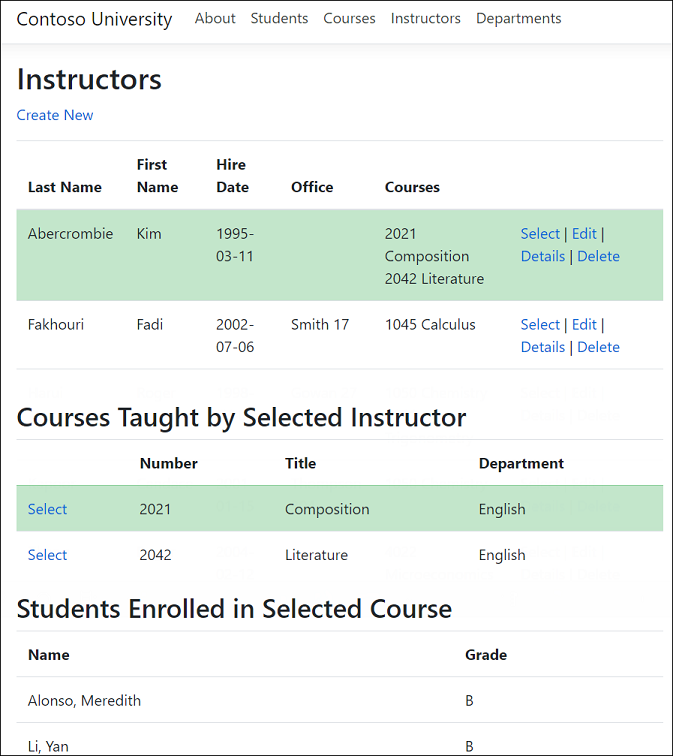
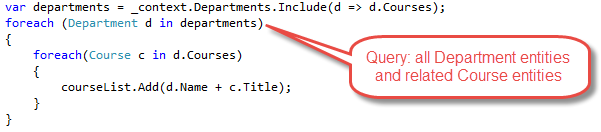
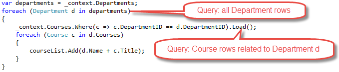
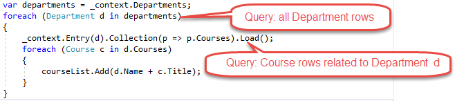
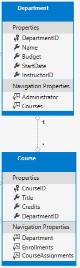
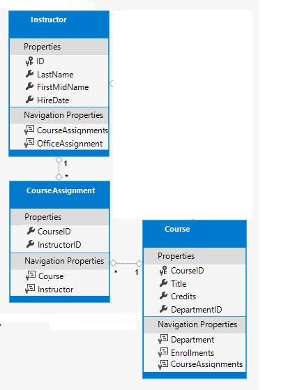

# Part 6, Razor Pages with EF Core in ASP.NET Core - Read Related Data

By [Tom Dykstra](https://github.com/tdykstra), [Jon P Smith](https://twitter.com/thereformedprog), and [Rick Anderson](https://twitter.com/RickAndMSFT)

[!INCLUDE [about the series](../../includes/RP-EF/intro.md)]

:::moniker range=">= aspnetcore-5.0"

This tutorial shows how to read and display related data. Related data is data that EF Core loads into navigation properties.

The following illustrations show the completed pages for this tutorial:




## Eager, explicit, and lazy loading

EF Core can load related data into the navigation properties of an entity in several ways:

* [Eager loading](/ef/core/querying/related-data#eager-loading). Eager loading is when a query for one type of entity also loads related entities. When you read an entity, EF Core retrieves its related data. This approach typically results in a single join query that retrieves all of the data you need. EF Core issues multiple queries for some types of eager loading. Issuing multiple queries can be more efficient than a large single query. Specify eager loading with the <xref:Microsoft.EntityFrameworkCore.EntityFrameworkQueryableExtensions.Include*> and <xref:Microsoft.EntityFrameworkCore.EntityFrameworkQueryableExtensions.ThenInclude*> methods.

  

  Eager loading sends multiple queries when a collection navigation is included:

  * One query for the main query 
  * One query for each collection "edge" in the load tree.

* Separate queries with `Load`: You can retrieve the data in separate queries, and EF Core "fixes up" the navigation properties. "Fixes up" means that EF Core automatically populates the navigation properties. Separate queries with `Load` is more like explicit loading than eager loading.

  

  **Note:** EF Core automatically fixes up navigation properties to any other entities that it previously loaded into the context instance. Even if you don't explicitly include the data for a navigation property, the property might still be populated if some or all of the related entities were previously loaded.

* [Explicit loading](/ef/core/querying/related-data#explicit-loading). When you first read the entity, EF Core doesn't retrieve related data. You must write code to retrieve the related data when it's needed. Explicit loading with separate queries results in multiple queries sent to the database. With explicit loading, you specify the navigation properties to load. Use the `Load` method to do explicit loading. For example:

  

* [Lazy loading](/ef/core/querying/related-data#lazy-loading). When you first read the entity, EF Core doesn't retrieve related data. The first time you access a navigation property, EF Core automatically retrieves the data required for that navigation property. EF Core sends a query to the database each time you access a navigation property for the first time. Lazy loading can hurt performance, for example when developers use [N+1 queries](https://www.bing.com/search?q=N%2B1+queries). N+1 queries load a parent and enumerate through children.

## Create Course pages

The `Course` entity includes a navigation property that contains the related `Department` entity.



To display the name of the assigned department for a course:

* Load the related `Department` entity into the `Course.Department` navigation property.
* Get the name from the `Department` entity's `Name` property.

<a name="scaffold"></a>

### Scaffold Course pages

# [Visual Studio](#tab/visual-studio)

* Follow the instructions in [Scaffold Student pages](intro.md#scaffold-student-pages) with the following exceptions:

  * Create a *Pages/Courses* folder.
  * Use `Course` for the model class.
  * Use the existing context class instead of creating a new one.

# [Visual Studio Code](#tab/visual-studio-code)

* Create a *Pages/Courses* folder.

* Run the following command to scaffold the Course pages.

  **On Windows:**

  ```dotnetcli
  dotnet aspnet-codegenerator razorpage -m Course -dc SchoolContext -udl -outDir Pages\Courses --referenceScriptLibraries
  ```

  **On Linux or macOS:**

  ```dotnetcli
  dotnet aspnet-codegenerator razorpage -m Course -dc SchoolContext -udl -outDir Pages/Courses --referenceScriptLibraries
  ```

---

* Open `Pages/Courses/Index.cshtml.cs` and examine the `OnGetAsync` method. The scaffolding engine specified eager loading for the `Department` navigation property. The `Include` method specifies eager loading.

* Run the app and select the **Courses** link. The department column displays the `DepartmentID`, which isn't useful.

### Display the department name

Update Pages/Courses/Index.cshtml.cs with the following code:

[!code-csharp[](intro/samples/cu30/Pages/Courses/Index.cshtml.cs?highlight=18,22,24)]

The preceding code changes the `Course` property to `Courses` and adds `AsNoTracking`. 

No-tracking queries are useful when the results are used in a read-only scenario. They're generally quicker to execute because there's no need to set up the change tracking information. If the entities retrieved from the database don't need to be updated, then a no-tracking query is likely to perform better than a tracking query.

In some cases a tracking query is more efficient than a no-tracking query. For more information, see [Tracking vs. No-Tracking Queries](/ef/core/querying/tracking).
In the preceding code, `AsNoTracking` is called because the entities aren't updated in the current context.

Update `Pages/Courses/Index.cshtml` with the following code.

[!code-cshtml[](intro/samples/cu30/Pages/Courses/Index.cshtml?highlight=5,8,16-18,20,23,26,32,35-37,45)]

The following changes have been made to the scaffolded code:

* Changed the `Course` property name to `Courses`.
* Added a **Number** column that shows the `CourseID` property value. By default, primary keys aren't scaffolded because normally they're meaningless to end users. However, in this case the primary key is meaningful.
* Changed the **Department** column to display the department name. The code displays the `Name` property of the `Department` entity that's loaded into the `Department` navigation property:

  ```html
  @Html.DisplayFor(modelItem => item.Department.Name)
  ```

Run the app and select the **Courses** tab to see the list with department names.


<a name="select"></a>

### Loading related data with Select

The `OnGetAsync` method loads related data with the `Include` method. The `Select` method is an alternative that loads only the related data needed. For single items, like the `Department.Name` it uses a `SQL INNER JOIN`. For collections, it uses another database access, but so does the `Include` operator on collections.

> [!NOTE]
> The `Select` method used here is a LINQ **projection** operator. It transforms each element in the source sequence into a new form—in this case, a `CourseViewModel`. Because the query projects into a non-entity type, EF Core generates a SQL query that retrieves only the columns needed for the projection, and no entity tracking is performed.

The following code loads related data with the `Select` method:

[!code-csharp[](intro/samples/cu50/Pages/Courses/IndexSelectModel.cshtml.cs?name=snippet_RevisedIndexMethod&highlight=6)]

The preceding code doesn't return any entity types, therefore no tracking is done. For more information about the EF tracking, see [Tracking vs. No-Tracking Queries](/ef/core/querying/tracking).

The `CourseViewModel`:

[!code-csharp[](intro/samples/cu50/Models/SchoolViewModels/CourseViewModel.cs)]

See [IndexSelectModel](https://github.com/dotnet/AspNetCore.Docs/tree/main/aspnetcore/data/ef-rp/intro/samples/cu50/Pages/Courses) for the complete Razor Pages.

## Create Instructor pages

This section scaffolds Instructor pages and adds related Courses and Enrollments to the Instructors Index page.

<a name="IP"></a>


This page reads and displays related data in the following ways:

* The list of instructors displays related data from the `OfficeAssignment` entity (Office in the preceding image). The `Instructor` and `OfficeAssignment` entities are in a one-to-zero-or-one relationship. Eager loading is used for the `OfficeAssignment` entities. Eager loading is typically more efficient when the related data needs to be displayed. In this case, office assignments for the instructors are displayed.
* When the user selects an instructor, related `Course` entities are displayed. The `Instructor` and `Course` entities are in a many-to-many relationship. Eager loading is used for the `Course` entities and their related `Department` entities. In this case, separate queries might be more efficient because only courses for the selected instructor are needed. This example shows how to use eager loading for navigation properties in entities that are in navigation properties.
* When the user selects a course, related data from the `Enrollments` entity is displayed. In the preceding image, student name and grade are displayed. The `Course` and `Enrollment` entities are in a one-to-many relationship.

### Create a view model

The instructors page shows data from three different tables. A view model is needed that includes three properties representing the three tables.

Create `Models/SchoolViewModels/InstructorIndexData.cs` with the following code:

[!code-csharp[](intro/samples/cu50/Models/SchoolViewModels/InstructorIndexData.cs)]

### Scaffold Instructor pages

# [Visual Studio](#tab/visual-studio)

* Follow the instructions in [Scaffold the student pages](intro.md#scaffold-student-pages) with the following exceptions:

  * Create a *Pages/Instructors* folder.
  * Use `Instructor` for the model class.
  * Use the existing context class instead of creating a new one.

# [Visual Studio Code](#tab/visual-studio-code)

* Create a *Pages/Instructors* folder.

* Run the following command to scaffold the Instructor pages.

  **On Windows:**

  ```dotnetcli
  dotnet aspnet-codegenerator razorpage -m Instructor -dc SchoolContext -udl -outDir Pages\Instructors --referenceScriptLibraries
  ```

  **On Linux or macOS:**

  ```dotnetcli
  dotnet aspnet-codegenerator razorpage -m Instructor -dc SchoolContext -udl -outDir Pages/Instructors --referenceScriptLibraries
  ```

---

Run the app and navigate to the Instructors page.

Update `Pages/Instructors/Index.cshtml.cs` with the following code:

[!code-csharp[](intro/samples/cu50/Pages/Instructors/Index.cshtml.cs?name=snippet_all)]

The `OnGetAsync` method accepts optional route data for the ID of the selected instructor.

Examine the query in the `Pages/Instructors/Index.cshtml.cs` file:

[!code-csharp[](intro/samples/cu50/Pages/Instructors/Index.cshtml.cs?name=snippet_query)]

The code specifies eager loading for the following navigation properties:

* `Instructor.OfficeAssignment`
* `Instructor.Courses`
    * `Course.Department`

The following code executes when an instructor is selected, that is, `id != null`.

[!code-csharp[](intro/samples/cu50/Pages/Instructors/Index.cshtml.cs?name=snippet_id)]

The selected instructor is retrieved from the list of instructors in the view model. The view model's `Courses` property is loaded with the `Course` entities from the selected instructor's `Courses` navigation property.

The `Where` method returns a collection. In this case, the filter selects a single entity, so the `Single` method is called to convert the collection into a single `Instructor` entity. The `Instructor` entity provides access to the `Course` navigation property.

The <xref:System.Linq.Enumerable.Single*> method is used on a collection when the collection has only one item. The `Single` method throws an exception if the collection is empty or if there's more than one item. An alternative is <xref:System.Linq.Enumerable.SingleOrDefault*>, which returns a default value if the collection is empty. For this query, `null` in the default returned.

The following code populates the view model's `Enrollments` property when a course is selected:

[!code-csharp[](intro/samples/cu50/Pages/Instructors/Index.cshtml.cs?name=snippet_enrollment)]

### Update the instructors Index page

Update `Pages/Instructors/Index.cshtml` with the following code.

[!code-cshtml[](intro/samples/cu50/Pages/Instructors/Index.cshtml?highlight=1)]

The preceding code makes the following changes:

  * Updates the `page` directive to `@page "{id:int?}"`. `"{id:int?}"` is a route template. The [route template](../../fundamentals/routing.md#route-templates) changes integer query strings in the URL to route data. For example, clicking on the **Select** link for an instructor with only the `@page` directive produces a URL like the following:

    `https://localhost:5001/Instructors?id=2`

    When the page directive is `@page "{id:int?}"`, the URL is:
    `https://localhost:5001/Instructors/2`

  * Adds an **Office** column that displays `item.OfficeAssignment.Location` only if `item.OfficeAssignment` isn't null. Because this is a one-to-zero-or-one relationship, there might not be a related OfficeAssignment entity.

    ```html
    @if (item.OfficeAssignment != null)
    {
        @item.OfficeAssignment.Location
    }
    ```

  * Adds a **Courses** column that displays courses taught by each instructor. See [Explicit line transition](../../mvc/views/razor.md#explicit-line-transition) for more about this razor syntax.
  * Adds code that dynamically adds `class="table-success"` to the `tr` element of the selected instructor and course. This sets a background color for the selected row using a Bootstrap class.

    ```html
    string selectedRow = "";
    if (item.CourseID == Model.CourseID)
    {
        selectedRow = "table-success";
    }
    <tr class="@selectedRow">
    ```

  * Adds a new hyperlink labeled **Select**. This link sends the selected instructor's ID to the `Index` method and sets a background color.

    ```html
    <a asp-action="Index" asp-route-id="@item.ID">Select</a> |
    ```

  * Adds a table of courses for the selected Instructor.
  * Adds a table of student enrollments for the selected course.

Run the app and select the **Instructors** tab. The page displays the `Location` (office) from the related `OfficeAssignment` entity. If `OfficeAssignment` is null, an empty table cell is displayed.

Click on the **Select** link for an instructor. The row style changes and courses assigned to that instructor are displayed.

Select a course to see the list of enrolled students and their grades.


## Next steps

The next tutorial shows how to update related data.

>[!div class="step-by-step"]
>[Previous tutorial](complex-data-model.md)
>[Next tutorial](update-related-data.md)

:::moniker-end

:::moniker range=">= aspnetcore-3.0 < aspnetcore-5.0"

This tutorial shows how to read and display related data. Related data is data that EF Core loads into navigation properties.

The following illustrations show the completed pages for this tutorial:


## Eager, explicit, and lazy loading

EF Core can load related data into the navigation properties of an entity in several ways:

* [Eager loading](/ef/core/querying/related-data#eager-loading). Eager loading is when a query for one type of entity also loads related entities. When an entity is read, its related data is retrieved. This typically results in a single join query that retrieves all of the data that's needed. EF Core will issue multiple queries for some types of eager loading. Issuing multiple queries can be more efficient than a giant single query. Eager loading is specified with the `Include` and `ThenInclude` methods.

  
 
  Eager loading sends multiple queries when a collection navigation is included:

  * One query for the main query 
  * One query for each collection "edge" in the load tree.

* Separate queries with `Load`: You can retrieve the data in separate queries, and EF Core "fixes up" the navigation properties. "Fixes up" means that EF Core automatically populates the navigation properties. Separate queries with `Load` is more like explicit loading than eager loading.

  

  **Note:** EF Core automatically fixes up navigation properties to any other entities that it previously loaded into the context instance. Even if you don't explicitly include the data for a navigation property, the property might still be populated if some or all of the related entities were previously loaded.

* [Explicit loading](/ef/core/querying/related-data#explicit-loading). When you first read the entity, EF Core doesn't retrieve related data. You must write code to retrieve the related data when it's needed. Explicit loading with separate queries results in multiple queries sent to the database. With explicit loading, you specify the navigation properties to load. Use the `Load` method to do explicit loading. For example:

  

* [Lazy loading](/ef/core/querying/related-data#lazy-loading). When the entity is first read, related data isn't retrieved. The first time a navigation property is accessed, the data required for that navigation property is automatically retrieved. A query is sent to the database each time a navigation property is accessed for the first time. Lazy loading can hurt performance, for example when developers use N+1 patterns, loading a parent and enumerating through children.

## Create Course pages

The `Course` entity includes a navigation property that contains the related `Department` entity.


To display the name of the assigned department for a course:

* Load the related `Department` entity into the `Course.Department` navigation property.
* Get the name from the `Department` entity's `Name` property.

<a name="scaffold"></a>

### Scaffold Course pages

# [Visual Studio](#tab/visual-studio)

* Follow the instructions in [Scaffold Student pages](intro.md#scaffold-student-pages) with the following exceptions:

  * Create a *Pages/Courses* folder.
  * Use `Course` for the model class.
  * Use the existing context class instead of creating a new one.

# [Visual Studio Code](#tab/visual-studio-code)

* Create a *Pages/Courses* folder.

* Run the following command to scaffold the Course pages.

  **On Windows:**

  ```dotnetcli
  dotnet aspnet-codegenerator razorpage -m Course -dc SchoolContext -udl -outDir Pages\Courses --referenceScriptLibraries
  ```

  **On Linux or macOS:**

  ```dotnetcli
  dotnet aspnet-codegenerator razorpage -m Course -dc SchoolContext -udl -outDir Pages/Courses --referenceScriptLibraries
  ```

---

* Open `Pages/Courses/Index.cshtml.cs` and examine the `OnGetAsync` method. The scaffolding engine specified eager loading for the `Department` navigation property. The `Include` method specifies eager loading.

* Run the app and select the **Courses** link. The department column displays the `DepartmentID`, which isn't useful.

### Display the department name

Update Pages/Courses/Index.cshtml.cs with the following code:

[!code-csharp[](intro/samples/cu30/Pages/Courses/Index.cshtml.cs?highlight=18,22,24)]

The preceding code changes the `Course` property to `Courses` and adds `AsNoTracking`. `AsNoTracking` improves performance because the entities returned are not tracked. The entities don't need to be tracked because they're not updated in the current context.

Update `Pages/Courses/Index.cshtml` with the following code.

[!code-cshtml[](intro/samples/cu30/Pages/Courses/Index.cshtml?highlight=5,8,16-18,20,23,26,32,35-37,45)]

The following changes have been made to the scaffolded code:

* Changed the `Course` property name to `Courses`.
* Added a **Number** column that shows the `CourseID` property value. By default, primary keys aren't scaffolded because normally they're meaningless to end users. However, in this case the primary key is meaningful.
* Changed the **Department** column to display the department name. The code displays the `Name` property of the `Department` entity that's loaded into the `Department` navigation property:

  ```html
  @Html.DisplayFor(modelItem => item.Department.Name)
  ```

Run the app and select the **Courses** tab to see the list with department names.


<a name="select"></a>

### Loading related data with Select

The `OnGetAsync` method loads related data with the `Include` method. The `Select` method is an alternative that loads only the related data needed. For single items, like the `Department.Name` it uses a SQL INNER JOIN. For collections, it uses another database access, but so does the `Include` operator on collections.

> [!NOTE]
> The `Select` method used here is a LINQ **projection** operator. It transforms each element in the source sequence into a new form—in this case, a `CourseViewModel`. Because the query projects into a non-entity type, EF Core generates a SQL query that retrieves only the columns needed for the projection, and no entity tracking is performed.

The following code loads related data with the `Select` method:

[!code-csharp[](intro/samples/cu30snapshots/6-related/Pages/Courses/IndexSelect.cshtml.cs?name=snippet_RevisedIndexMethod&highlight=6)]

The preceding code doesn't return any entity types, therefore no tracking is done. For more information about the EF tracking, see [Tracking vs. No-Tracking Queries](/ef/core/querying/tracking).

The `CourseViewModel`:

[!code-csharp[](intro/samples/cu30snapshots/6-related/Models/SchoolViewModels/CourseViewModel.cs?name=snippet)]

See [IndexSelect.cshtml](https://github.com/dotnet/AspNetCore.Docs/tree/main/aspnetcore/data/ef-rp/intro/samples/cu30snapshots/6-related/Pages/Courses/IndexSelect.cshtml) and [IndexSelect.cshtml.cs](https://github.com/dotnet/AspNetCore.Docs/tree/main/aspnetcore/data/ef-rp/intro/samples/cu30snapshots/6-related/Pages/Courses/IndexSelect.cshtml.cs) for a complete example.

## Create Instructor pages

This section scaffolds Instructor pages and adds related Courses and Enrollments to the Instructors Index page.

<a name="IP"></a>


This page reads and displays related data in the following ways:

* The list of instructors displays related data from the `OfficeAssignment` entity (Office in the preceding image). The `Instructor` and `OfficeAssignment` entities are in a one-to-zero-or-one relationship. Eager loading is used for the `OfficeAssignment` entities. Eager loading is typically more efficient when the related data needs to be displayed. In this case, office assignments for the instructors are displayed.
* When the user selects an instructor, related `Course` entities are displayed. The `Instructor` and `Course` entities are in a many-to-many relationship. Eager loading is used for the `Course` entities and their related `Department` entities. In this case, separate queries might be more efficient because only courses for the selected instructor are needed. This example shows how to use eager loading for navigation properties in entities that are in navigation properties.
* When the user selects a course, related data from the `Enrollments` entity is displayed. In the preceding image, student name and grade are displayed. The `Course` and `Enrollment` entities are in a one-to-many relationship.

### Create a view model

The instructors page shows data from three different tables. A view model is needed that includes three properties representing the three tables.

Create `SchoolViewModels/InstructorIndexData.cs` with the following code:

[!code-csharp[](intro/samples/cu30/Models/SchoolViewModels/InstructorIndexData.cs)]

### Scaffold Instructor pages

# [Visual Studio](#tab/visual-studio)

* Follow the instructions in [Scaffold the student pages](intro.md#scaffold-student-pages) with the following exceptions:

  * Create a *Pages/Instructors* folder.
  * Use `Instructor` for the model class.
  * Use the existing context class instead of creating a new one.

# [Visual Studio Code](#tab/visual-studio-code)

* Create a *Pages/Instructors* folder.

* Run the following command to scaffold the Instructor pages.

  **On Windows:**

  ```dotnetcli
  dotnet aspnet-codegenerator razorpage -m Instructor -dc SchoolContext -udl -outDir Pages\Instructors --referenceScriptLibraries
  ```

  **On Linux or macOS:**

  ```dotnetcli
  dotnet aspnet-codegenerator razorpage -m Instructor -dc SchoolContext -udl -outDir Pages/Instructors --referenceScriptLibraries
  ```

---

To see what the scaffolded page looks like before you update it, run the app and navigate to the Instructors page.

Update `Pages/Instructors/Index.cshtml.cs` with the following code:

[!code-csharp[](intro/samples/cu30snapshots/6-related/Pages/Instructors/Index1.cshtml.cs?name=snippet_all&highlight=2,19-53)]

The `OnGetAsync` method accepts optional route data for the ID of the selected instructor.

Examine the query in the `Pages/Instructors/Index.cshtml.cs` file:

[!code-csharp[](intro/samples/cu30snapshots/6-related/Pages/Instructors/Index1.cshtml.cs?name=snippet_EagerLoading)]

The code specifies eager loading for the following navigation properties:

* `Instructor.OfficeAssignment`
* `Instructor.CourseAssignments`
  * `CourseAssignments.Course`
    * `Course.Department`
    * `Course.Enrollments`
      * `Enrollment.Student`

Notice the repetition of `Include` and `ThenInclude` methods for `CourseAssignments` and `Course`. This repetition is necessary to specify eager loading for two navigation properties of the `Course` entity.

The following code executes when an instructor is selected (`id != null`).

[!code-csharp[](intro/samples/cu30snapshots/6-related/Pages/Instructors/Index1.cshtml.cs?name=snippet_SelectInstructor)]

The selected instructor is retrieved from the list of instructors in the view model. The view model's `Courses` property is loaded with the `Course` entities from that instructor's `CourseAssignments` navigation property.

The `Where` method returns a collection. But in this case, the filter will select a single entity, so the `Single` method is called to convert the collection into a single `Instructor` entity. The `Instructor` entity provides access to the `CourseAssignments` property. `CourseAssignments` provides access to the related `Course` entities.



The `Single` method is used on a collection when the collection has only one item. The `Single` method throws an exception if the collection is empty or if there's more than one item. An alternative is `SingleOrDefault`, which returns a default value (null in this case) if the collection is empty.

The following code populates the view model's `Enrollments` property when a course is selected:

[!code-csharp[](intro/samples/cu30snapshots/6-related/Pages/Instructors/Index1.cshtml.cs?name=snippet_SelectCourse)]

### Update the instructors Index page

Update `Pages/Instructors/Index.cshtml` with the following code.

[!code-cshtml[](intro/samples/cu30/Pages/Instructors/Index.cshtml?highlight=1,5,8,16-21,25-32,43-57,67-102,104-126)]

The preceding code makes the following changes:

* Updates the `page` directive from `@page` to `@page "{id:int?}"`. `"{id:int?}"` is a route template. The route template changes integer query strings in the URL to route data. For example, clicking on the **Select** link for an instructor with only the `@page` directive produces a URL like the following:

  `https://localhost:5001/Instructors?id=2`

  When the page directive is `@page "{id:int?}"`, the URL is:

  `https://localhost:5001/Instructors/2`

* Adds an **Office** column that displays `item.OfficeAssignment.Location` only if `item.OfficeAssignment` isn't null. Because this is a one-to-zero-or-one relationship, there might not be a related OfficeAssignment entity.

  ```html
  @if (item.OfficeAssignment != null)
  {
      @item.OfficeAssignment.Location
  }
  ```

* Adds a **Courses** column that displays courses taught by each instructor. See [Explicit line transition](../../mvc/views/razor.md#explicit-line-transition) for more about this razor syntax.

* Adds code that dynamically adds `class="table-success"` to the `tr` element of the selected instructor and course. This sets a background color for the selected row using a Bootstrap class.

  ```html
  string selectedRow = "";
  if (item.CourseID == Model.CourseID)
  {
      selectedRow = "table-success";
  }
  <tr class="@selectedRow">
  ```

* Adds a new hyperlink labeled **Select**. This link sends the selected instructor's ID to the `Index` method and sets a background color.

  ```html
  <a asp-action="Index" asp-route-id="@item.ID">Select</a> |
  ```

* Adds a table of courses for the selected Instructor.

* Adds a table of student enrollments for the selected course.

Run the app and select the **Instructors** tab. The page displays the `Location` (office) from the related `OfficeAssignment` entity. If `OfficeAssignment` is null, an empty table cell is displayed.

Click on the **Select** link for an instructor. The row style changes and courses assigned to that instructor are displayed.

Select a course to see the list of enrolled students and their grades.


## Using Single

The `Single` method can pass in the `Where` condition instead of calling the `Where` method separately:

[!code-csharp[](intro/samples/cu30snapshots/6-related/Pages/Instructors/IndexSingle.cshtml.cs?name=snippet_single&highlight=21-22,30-31)]

Use of `Single` with a Where condition is a matter of personal preference. It provides no benefits over using the `Where` method.

## Explicit loading

The current code specifies eager loading for `Enrollments` and `Students`:

[!code-csharp[](intro/samples/cu30snapshots/6-related/Pages/Instructors/Index1.cshtml.cs?name=snippet_EagerLoading&highlight=6-9)]

Suppose users rarely want to see enrollments in a course. In that case, an optimization would be to only load the enrollment data if it's requested. In this section, the `OnGetAsync` is updated to use explicit loading of `Enrollments` and `Students`.

Update `Pages/Instructors/Index.cshtml.cs` with the following code.

[!code-csharp[](intro/samples/cu30/Pages/Instructors/Index.cshtml.cs?highlight=31-35,52-56)]

The preceding code drops the *ThenInclude* method calls for enrollment and student data. If a course is selected, the explicit loading code retrieves:

* The `Enrollment` entities for the selected course.
* The `Student` entities for each `Enrollment`.

Notice that the preceding code comments out `.AsNoTracking()`. Navigation properties can only be explicitly loaded for tracked entities.

Test the app. From a user's perspective, the app behaves identically to the previous version.

## Next steps

The next tutorial shows how to update related data.

>[!div class="step-by-step"]
>[Previous tutorial](complex-data-model.md)
>[Next tutorial](update-related-data.md)

:::moniker-end
