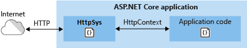
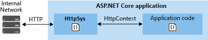
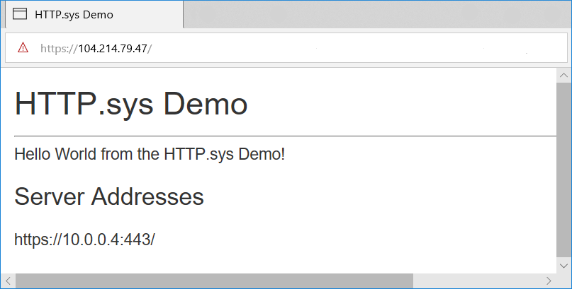

# HTTP.sys web server implementation in ASP.NET Core

[!INCLUDE[](~/includes/not-latest-version-without-not-supported-content.md)]

By [Tom Dykstra](https://github.com/tdykstra) and [Chris Ross](https://github.com/Tratcher)

:::moniker range=">= aspnetcore-10.0"

[HTTP.sys](/iis/get-started/introduction-to-iis/introduction-to-iis-architecture#hypertext-transfer-protocol-stack-httpsys) is a [web server for ASP.NET Core](index.md) that only runs on Windows. HTTP.sys is an alternative to [Kestrel](kestrel.md) server and offers some features that Kestrel doesn't provide. This article explains when to use HTTP.sys, how to configure it, and how to inspect request and TLS information.

> [!IMPORTANT]
> HTTP.sys isn't compatible with the [ASP.NET Core Module](../../host-and-deploy/aspnet-core-module.md) and can't be used with IIS or IIS Express.

HTTP.sys supports the following features:

* [Windows Authentication](../../security/authentication/windowsauth.md)
* Port sharing
* HTTPS with SNI
* HTTP/2 over TLS (Windows 10 or later)
* HTTP/3 over TLS (Windows 11 or later)
* Direct file transmission
* Response caching
* WebSockets (Windows 8 or later)
* Customizable security descriptors
* Automatic memory pool eviction

The operating system must be supported by the app's target version of .NET. For supported Windows versions, see [Install .NET on Windows](/dotnet/core/install/windows#supported-versions). The availability of HTTP.sys on older Windows versions doesn't imply support for those versions by current ASP.NET Core releases. Individual features can have additional Windows requirements, as described in the following sections.

[View or download sample code](https://github.com/dotnet/AspNetCore.Docs/tree/main/aspnetcore/fundamentals/servers/httpsys/samples) ([how to download](../index.md#how-to-download-a-sample))

## When to use HTTP.sys

HTTP.sys is useful for deployments where:

* There's a need to expose the server directly to the Internet without using IIS.

  

* An internal deployment requires a feature not available in Kestrel. For more information, see [Kestrel vs. HTTP.sys](index.md#kestrel-vs-httpsys)

  

HTTP.sys is mature technology that protects against many types of attacks and provides the robustness, security, and scalability of a full-featured web server. IIS itself runs as an HTTP listener on top of HTTP.sys.

## HTTP/2 support

[HTTP/2](https://httpwg.org/specs/rfc7540.html) is enabled for ASP.NET Core apps when the following base requirements are met:

* Windows Server 2016/Windows 10 or later
* [Application-Layer Protocol Negotiation (ALPN)](https://tools.ietf.org/html/rfc7301#section-3) connection
* TLS 1.2 or later connection

If an HTTP/2 connection is established, [HttpRequest.Protocol](xref:Microsoft.AspNetCore.Http.HttpRequest.Protocol) reports `HTTP/2`.

HTTP/2 is enabled by default. If an HTTP/2 connection isn't established, the connection falls back to HTTP/1.1. On Windows versions that support it, the `disablehttp2` option on a `netsh http` SSL certificate binding disables HTTP/2 for that binding. For available options, see [netsh http](/windows-server/administration/windows-commands/netsh-http).

## HTTP/3 support

[HTTP/3](https://datatracker.ietf.org/doc/rfc9114/) is enabled for ASP.NET Core apps when the following base requirements are met:

* Windows Server 2022/Windows 11 or later
* An `https` url binding is used.
* The [EnableHttp3 registry key](https://techcommunity.microsoft.com/t5/networking-blog/enabling-http-3-support-on-windows-server-2022/ba-p/2676880) is set.

The preceding Windows 11 Build versions may require the use of a [Windows Insider](https://www.microsoft.com/en-us/windowsinsider/) build.

HTTP/3 is discovered as an upgrade from HTTP/1.1 or HTTP/2 via the `alt-svc` header. That means the first request will normally use HTTP/1.1 or HTTP/2 before switching to HTTP/3. Http.Sys doesn't automatically add the `alt-svc` header, it must be added by the application. The following code is a middleware example that adds the `alt-svc` response header.

```csharp
app.Use((context, next) =>
{
    context.Response.Headers.AltSvc = "h3=\":443\"";
    return next(context);
});
```

Place the preceding code early in the request pipeline.

Http.Sys also supports sending an AltSvc HTTP/2 protocol message rather than a response header to notify the client that HTTP/3 is available. See the [EnableAltSvc registry key](https://techcommunity.microsoft.com/t5/networking-blog/enabling-http-3-support-on-windows-server-2022/ba-p/2676880).

> [!NOTE]
> This requires netsh sslcert bindings that use host names rather than IP addresses. Replace `ipport` with `hostnameport` in the `netsh http add sslcert` commands below, and replace the IP address with the hostname, for example, `www.example.com`. There's also a known issue where using `hostnameport` fails unless the `certstorename` parameter is specified. By default, use `certstorename=MY`.

## Kernel mode authentication with Kerberos

HTTP.sys delegates to kernel mode authentication with the Kerberos authentication protocol. User mode authentication isn't supported with Kerberos and HTTP.sys. The machine account must be used to decrypt the Kerberos token/ticket that's obtained from Active Directory and forwarded by the client to the server to authenticate the user. Register the Service Principal Name (SPN) for the host, not the user of the app.

### Enable channel binding token (CBT) hardening

Channel binding tokens (CBT) tie Windows authentication to the underlying TLS channel, which helps mitigate NTLM relay and man-in-the-middle attacks.

::: moniker-end

:::moniker range=">= aspnetcore-11.0"

Configure CBT hardening with <xref:Microsoft.AspNetCore.Server.HttpSys.HttpSysOptions.HttpAuthenticationHardeningLevel>. The available <xref:Microsoft.AspNetCore.Server.HttpSys.HttpAuthenticationHardeningLevel> values are:

| Value | Behavior |
| --- | --- |
| `Legacy` | Doesn't enforce channel binding validation or expose CBT bytes to the app. |
| `Medium` (default) | Validates CBTs when clients supply them, but permits their absence. Exposes CBT bytes to the app. |
| `Strict` | Requires CBTs on authenticated requests and rejects requests without them. Exposes CBT bytes to the app. |

The following example opts in to `Strict` hardening:

:::code language="csharp" source="httpsys/snippets/11.0/Program.cs" id="snippet_hardening":::

If HTTP.sys can't apply `Strict` hardening, server startup fails with a `HttpSysException`. With `Legacy` or `Medium`, a failure to apply the setting is logged, and startup continues. The configured value alone doesn't guarantee that the operating system applied the setting.

> [!WARNING]
> `Strict` hardening can cause Windows authentication to fail for clients or proxies that don't supply a valid CBT. Test client compatibility and TLS termination in your environment before enabling it in production.

When attaching to an existing request queue, configure hardening on the listener that owns the URL group. The attaching app doesn't apply URL-group configuration.

For access to CBT bytes, see [Get channel binding tokens](#get-channel-binding-tokens).

:::moniker-end

:::moniker range=">= aspnetcore-10.0 < aspnetcore-11.0"

Opt in to CBT hardening for HTTPS endpoints that use Windows authentication by setting the `Microsoft.AspNetCore.Server.HttpSys.EnableCBTHardening` AppContext switch to `true`. This switch selects medium hardening, which validates supplied CBTs but permits their absence.

Enable the switch in your project's `runtimeconfig.template.json` file:

```json
{
  "configProperties": {
    "Microsoft.AspNetCore.Server.HttpSys.EnableCBTHardening": true
  }
}
```

Alternatively, set the switch programmatically before building the host in the `Program` file:

```csharp
AppContext.SetSwitch("Microsoft.AspNetCore.Server.HttpSys.EnableCBTHardening", true);
```

> [!WARNING]
> CBT hardening is off by default. Enabling it can cause Windows authentication to fail for clients or proxies that don't support channel binding. Test thoroughly in your environment before enabling in production.

:::moniker-end

:::moniker range=">= aspnetcore-10.0"

### Support for kernel-mode response buffering

In some scenarios, high volumes of small writes with high latency can cause significant performance impact to `HTTP.sys`. This impact is due to the lack of a <xref:System.IO.Pipelines.Pipe> buffer in the `HTTP.sys` implementation. To improve performance in these scenarios, support for response buffering is included in `HTTP.sys`. Enable buffering by setting <xref:Microsoft.AspNetCore.Server.HttpSys.HttpSysOptions.EnableKernelResponseBuffering> to `true`.
Response buffering should be enabled by an app that does synchronous I/O, or asynchronous I/O with no more than one outstanding write at a time. In these scenarios, response buffering can significantly improve throughput over high-latency connections.

Apps that use asynchronous I/O and that may have more than one write outstanding at a time should **_not_** use this flag. Enabling this flag can result in higher CPU and memory usage by HTTP.Sys.

## How to use HTTP.sys

### Configure the ASP.NET Core app to use HTTP.sys

Call the <xref:Microsoft.AspNetCore.Hosting.WebHostBuilderHttpSysExtensions.UseHttpSys*> extension method when building the host, specifying any required <xref:Microsoft.AspNetCore.Server.HttpSys.HttpSysOptions>. The following example sets options to their default values:

:::code language="csharp" source="~/fundamentals/servers/httpsys/samples/SampleApp/Program.cs" id="snippet_1" highlight="8-16":::

Additional HTTP.sys configuration is handled through [registry settings](https://support.microsoft.com/help/820129/http-sys-registry-settings-for-windows).

For more information about HTTP.sys options, see <xref:Microsoft.AspNetCore.Server.HttpSys.HttpSysOptions>.

### Customize security descriptors

A *request queue* in HTTP.sys is a kernel-level structure that temporarily stores incoming HTTP requests until your app is ready to process them. Manage access to the request queue by using <xref:Microsoft.AspNetCore.Server.HttpSys.HttpSysOptions.RequestQueueSecurityDescriptor>. Set it to a <xref:System.Security.AccessControl.GenericSecurityDescriptor> instance when configuring your HTTP.sys server.

By customizing the security descriptor, you can allow or deny specific users or groups access to the request queue. This is useful in scenarios where you want to restrict or delegate HTTP.sys request handling at the operating system level.

For example, the following code allows all authenticated users but denies guests:

[!code-csharp[](~/fundamentals/servers/httpsys/samples/snapshot/10.x/HttpSysConfig/Program.cs)]

The `RequestQueueSecurityDescriptor` property applies only when creating a new request queue. The property doesn't affect existing request queues. When `RequestQueueMode` is `Attach`it opens an existing queue, queue-level options such as `RequestQueueSecurityDescriptor` and `RequestQueueLimit` don't apply. In `Attach` mode, URL-group settings, such as timeouts and authentication hardening, must be configured by the listener that owns the URL group, and `UrlPrefixes` is used only to compute `PathBase`. `CreateOrAttach` still configures its own URL group and registers its `UrlPrefixes`, even when the queue already exists; settings for prefixes already registered by another listener remain controlled by that listener.

<a name="maxrequestbodysize"></a>

**MaxRequestBodySize**

The maximum allowed size of any request body in bytes. When set to `null`, the maximum request body size is unlimited. This limit has no effect on upgraded connections, which are always unlimited.

The recommended method to override the limit in an ASP.NET Core MVC app for a single `IActionResult` is to use the <xref:Microsoft.AspNetCore.Mvc.RequestSizeLimitAttribute> attribute on an action method:

```csharp
[RequestSizeLimit(100000000)]
public IActionResult MyActionMethod()
```

An exception is thrown if the app attempts to configure the limit on a request after the app has started reading the request. An `IsReadOnly` property can be used to indicate if the `MaxRequestBodySize` property is in a read-only state, meaning it's too late to configure the limit.

If the app should override <xref:Microsoft.AspNetCore.Server.HttpSys.HttpSysOptions.MaxRequestBodySize> per-request, use the <xref:Microsoft.AspNetCore.Http.Features.IHttpMaxRequestBodySizeFeature>:

:::code language="csharp" source="~/fundamentals/servers/httpsys/samples/SampleApp/Program.cs" id="snippet_12" highlight="3-4":::

If using Visual Studio, make sure the app isn't configured to run IIS or IIS Express.

In Visual Studio, the default launch profile is for IIS Express. To run the project as a console app, manually change the selected profile, as shown in the following screenshot:

:::image type="content" source="~/fundamentals/servers/httpsys/_static/vs-choose-profile.png" alt-text="Select console app profile":::

### Configure Windows Server

1. Determine the ports to open for the app and use [Windows Firewall](/windows/security/threat-protection/windows-firewall/create-an-inbound-port-rule) or the [New-NetFirewallRule](/powershell/module/netsecurity/new-netfirewallrule) PowerShell cmdlet to open firewall ports to allow traffic to reach HTTP.sys. In the following commands and app configuration, port 443 is used.

1. When deploying to an Azure VM, open the ports in the [Network Security Group](/azure/virtual-machines/windows/nsg-quickstart-portal). In the following commands and app configuration, port 443 is used.

1. Obtain and install X.509 certificates, if required.

   On Windows, create self-signed certificates using the [New-SelfSignedCertificate PowerShell cmdlet](/powershell/module/pki/new-selfsignedcertificate). For an unsupported example, see [UpdateIISExpressSSLForChrome.ps1](https://github.com/dotnet/AspNetCore.Docs/tree/main/aspnetcore/includes/make-x509-cert/UpdateIISExpressSSLForChrome.ps1).

   Install either self-signed or CA-signed certificates in the server's **Local Machine** > **Personal** store.

1. If the app is a [framework-dependent deployment](/dotnet/core/deploying/#framework-dependent-deployments-fdd), install the matching ASP.NET Core Runtime and .NET Runtime from [.NET Downloads](https://dotnet.microsoft.com/download). The .NET SDK isn't required on the server. ASP.NET Core doesn't target .NET Framework. For installer contents, see [Choose the correct runtime](/dotnet/core/install/windows#choose-the-correct-runtime).

   If the app is a [self-contained deployment](/dotnet/core/deploying/#self-contained-deployments-scd), the app includes the runtime in its deployment. No framework installation is required on the server.

1. Configure URLs and ports in the app.

   By default, ASP.NET Core binds to `http://localhost:5000`. To configure URL prefixes and ports, options include:

   * <xref:Microsoft.AspNetCore.Hosting.HostingAbstractionsWebHostBuilderExtensions.UseUrls*>
   * `urls` command-line argument
   * `ASPNETCORE_URLS` environment variable
   * <xref:Microsoft.AspNetCore.Server.HttpSys.HttpSysOptions.UrlPrefixes>

   The following code example shows how to use <xref:Microsoft.AspNetCore.Server.HttpSys.HttpSysOptions.UrlPrefixes> with the server's local IP address `10.0.0.4` on port 443:

   :::code language="csharp" source="~/fundamentals/servers/httpsys/samples/SampleApp/Program.cs" id="snippet_11" highlight="5":::

   An advantage of `UrlPrefixes` is that an error message is generated immediately for improperly formatted prefixes.

   The settings in `UrlPrefixes` override `UseUrls`/`urls`/`ASPNETCORE_URLS` settings. Therefore, an advantage of `UseUrls`, `urls`, and the `ASPNETCORE_URLS` environment variable is that it's easier to switch between Kestrel and HTTP.sys.

   HTTP.sys recognizes two types of wild cards in URL prefixes:

   * `*` is a *weak binding*, also known as a *fallback binding*. If the URL prefix is `http://*:5000`, and something else is bound to port 5000, this binding won't be used.
   * `+` is a *strong binding*. If the URL prefix is `http://+:5000`, this binding will be used before other port 5000 bindings.

   For more information, see [UrlPrefix Strings](/windows/win32/http/urlprefix-strings).

   > [!WARNING]
   > Top-level wildcard bindings (`http://*:80/` and `http://+:80`) should **not** be used. Top-level wildcard bindings create app security vulnerabilities. This applies to both strong and weak wildcards. Use explicit host names or IP addresses rather than wildcards. Subdomain wildcard binding (for example, `*.mysub.com`) isn't a security risk if you control the entire parent domain (as opposed to `*.com`, which is vulnerable). For more information, see [RFC 9110: Section 7.2: Host and :authority](https://www.rfc-editor.org/rfc/rfc9110#field.host).

   [!INCLUDE[](~/includes/http-ports.md)]

   These configuration keys are equivalent to top-level wildcard bindings. They're convenient for development and container scenarios, but avoid wildcards when running on a machine that may also host other services.

1. Preregister URL prefixes on the server.

   The built-in tool for configuring HTTP.sys is *netsh.exe*. *netsh.exe* is used to reserve URL prefixes and assign X.509 certificates. The tool requires administrator privileges.

   Use the *netsh.exe* tool to register URLs for the app:

   ```console
   netsh http add urlacl url=<URL> user=<USER>
   ```

   * `<URL>`: The fully qualified Uniform Resource Locator (URL). Don't use a wildcard binding. Use a valid hostname or local IP address. *The URL must include a trailing slash.*
   * `<USER>`: Specifies the user or user-group name.

   In the following example, the local IP address of the server is `10.0.0.4`:

   ```console
   netsh http add urlacl url=https://10.0.0.4:443/ user=Users
   ```

   When a URL is registered, the tool responds with `URL reservation successfully added`.

   To delete a registered URL, use the `delete urlacl` command:

   ```console
   netsh http delete urlacl url=<URL>
   ```

1. Register X.509 certificates on the server.

   Use the *netsh.exe* tool to register certificates for the app:

   ```console
   netsh http add sslcert ipport=<IP>:<PORT> certhash=<THUMBPRINT> appid="{<GUID>}"
   ```

   * `<IP>`: Specifies the local IP address for the binding. Don't use a wildcard binding. Use a valid IP address.
   * `<PORT>`: Specifies the port for the binding.
   * `<THUMBPRINT>`: The X.509 certificate thumbprint.
   * `<GUID>`: A developer-generated GUID to represent the app for informational purposes.

   For reference purposes, store the GUID in the app as a package tag:

   * In Visual Studio:
     * Open the app's project properties by right-clicking on the app in **Solution Explorer** and selecting **Properties**.
     * Select the **Package** tab.
     * Enter the GUID that you created in the **Tags** field.
   * When not using Visual Studio:
     * Open the app's project file.
     * Add a `<PackageTags>` property to a new or existing `<PropertyGroup>` with the GUID that you created:

       ```xml
       <PropertyGroup>
         <PackageTags>00001111-aaaa-2222-bbbb-3333cccc4444</PackageTags>
       </PropertyGroup>
       ```

   In the following example:

   * The local IP address of the server is `10.0.0.4`.
   * An online random GUID generator provides the `appid` value.

   ```console
   netsh http add sslcert
       ipport=10.0.0.4:443
       certhash=b66ee04419d4ee37464ab8785ff02449980eae10
       appid="{00001111-aaaa-2222-bbbb-3333cccc4444}"
   ```

   When a certificate is registered, the tool responds with `SSL Certificate successfully added`.

   To delete a certificate registration, use the `delete sslcert` command:

   ```console
   netsh http delete sslcert ipport=<IP>:<PORT>
   ```

   Reference documentation for *netsh.exe*:

   * [`netsh http`](/windows-server/administration/windows-commands/netsh-http)
   * [UrlPrefix Strings](/windows/win32/http/urlprefix-strings)

1. Run the app.

   Run the app under the identity authorized by the URL reservation. Administrator privileges are required to configure URL reservations and certificate bindings but aren't required to run an app whose identity has the necessary namespace permissions. Binding to a local IP address or port 443 doesn't by itself require an elevated application process. For more information, see [Namespace reservations, registrations, and routing](/windows/win32/http/namespace-reservations-registrations-and-routing).

   The app responds at the server's public IP address. In this example, the server is reached from the Internet at its public IP address of `104.214.79.47`.

   A development certificate is used in this example. The page loads securely after bypassing the browser's untrusted certificate warning.

   

## Proxy server and load balancer scenarios

For apps hosted by HTTP.sys that interact with requests from the Internet or a corporate network, additional configuration might be required when hosting behind proxy servers and load balancers. For more information, see [Configure ASP.NET Core to work with proxy servers and load balancers](../../host-and-deploy/proxy-load-balancer.md).

:::moniker-end

:::moniker range=">= aspnetcore-11.0"

When processing a request with both a `Content-Length` header and a `Transfer-Encoding` header whose final coding is `chunked`, HTTP.sys removes `Content-Length` from the request headers surfaced to the app and closes the connection after responding by default. Proxies shouldn't send conflicting request framing. This behavior helps prevent request smuggling; it doesn't imply that every such request is rejected before reaching the app.

:::moniker-end

:::moniker range=">= aspnetcore-10.0"

## Inspect TLS and request properties

<!-- UPDATE 11.0 - Remove prerelease language -->

HTTP.sys exposes request features for inspecting TLS information. Availability depends on the request, the Windows version, and the HTTP.sys configuration.

### Get the negotiated TLS cipher suite

<xref:Microsoft.AspNetCore.Connections.Features.ITlsHandshakeFeature> exposes the negotiated cipher suite through its `NegotiatedCipherSuite` property for HTTP.sys. The feature isn't available for a non-TLS request. The property can be `null` if Windows doesn't support the query or the query fails.

:::code language="csharp" source="httpsys/snippets/11.0/HttpSysFeatureExamples.cs" id="snippet_cipher_suite":::

### Read the TLS ClientHello

Use <xref:Microsoft.AspNetCore.Server.HttpSys.IHttpSysRequestPropertyFeature.TryGetTlsClientHello*> to retrieve the raw TLS ClientHello bytes on demand. The HTTPS service configuration must enable `HTTP_SERVICE_CONFIG_SSL_FLAG_ENABLE_CACHE_CLIENT_HELLO`. Configuring ASP.NET Core to use HTTP.sys doesn't enable this native flag. See [`HttpSetServiceConfiguration`](/windows/win32/api/http/nf-http-httpsetserviceconfiguration) and [`HTTP_SERVICE_CONFIG_ID`](/windows/win32/api/http/ne-http-http_service_config_id).

First call the method with an empty span to obtain the required buffer size, then allocate a buffer and retry:

:::code language="csharp" source="httpsys/snippets/11.0/HttpSysFeatureExamples.cs" id="snippet_client_hello":::


:::moniker-end

:::moniker range=">= aspnetcore-11.0"

### Query other native request properties

<xref:Microsoft.AspNetCore.Server.HttpSys.IHttpSysRequestPropertyFeature.TryGetRequestProperty*> exposes [`HttpQueryRequestProperty`](/windows/win32/http/http/nf-http-httpqueryrequestproperty) for arbitrary native request properties.

* `propertyId` identifies a value from the native [`HTTP_REQUEST_PROPERTY`](/windows/win32/api/http/ne-http-http_request_property) enumeration.
* `qualifier` contains optional property-specific bytes. An empty span is passed to Windows as a null pointer.
* `output` receives the native bytes. The caller must interpret them using the corresponding native data structure.
* `bytesReturned` contains the bytes written on success. On an insufficient-buffer failure, required-size reporting depends on the native property. For fixed-size properties, allocate a buffer sized for the corresponding native structure instead of assuming that an empty-buffer query reports the required size.

The following example queries the TLS ClientHello property through the general-purpose API. It requires the same native ClientHello caching configuration as `TryGetTlsClientHello`:

:::code language="csharp" source="httpsys/snippets/11.0/HttpSysFeatureExamples.cs" id="snippet_request_property":::


### Get channel binding tokens

<xref:Microsoft.AspNetCore.Http.Features.ITlsConnectionFeature.TryGetChannelBindingBytes*> provides access to TLS channel binding bytes:

:::code language="csharp" source="httpsys/snippets/11.0/HttpSysFeatureExamples.cs" id="snippet_channel_binding":::

HTTP.sys supports `ChannelBindingKind.Endpoint`, corresponding to the `tls-server-end-point` binding defined by [RFC 5929](https://datatracker.ietf.org/doc/html/rfc5929). Other binding kinds return `false`. An unavailable token also returns `false`. CBT exposure requires `Medium` or `Strict` [authentication hardening](#enable-channel-binding-token-cbt-hardening) to be applied by HTTP.sys.

Retrieving CBT bytes doesn't by itself authenticate a request or enforce `Strict` hardening. The returned bytes contain the Windows `SEC_CHANNEL_BINDINGS` structure and its binding data, not just a certificate hash.

:::moniker-end

:::moniker range=">= aspnetcore-10.0"

<a name="ihsrtf8"></a>

## Get detailed timing information with IHttpSysRequestTimingFeature
<!--
<xref:Microsoft.AspNetCore.Server.HttpSys.IHttpSysRequestTimingFeature>
-->
[IHttpSysRequestTimingFeature](/dotnet/api/microsoft.aspnetcore.server.httpsys.ihttpsysrequesttimingfeature)  provides detailed timing information for requests:

* Timestamps are obtained using [QueryPerformanceCounter](/windows/win32/api/profileapi/nf-profileapi-queryperformancecounter).
* The timestamp frequency can be obtained via [QueryPerformanceFrequency](/windows/win32/api/profileapi/nf-profileapi-queryperformancefrequency).
* The index of the timing can be cast to [HttpSysRequestTimingType](/dotnet/api/microsoft.aspnetcore.server.httpsys.httpsysrequesttimingtype) to know what the timing represents.
* The value may be 0 if the timing isn't available for the current request.
* Requires Windows 10 version 2004, Windows Server 2022, or later.

:::code language="csharp" source="~/fundamentals/request-features/samples/IHttpSysRequestTimingFeature/Program.cs" id="snippet_WithTimestamps":::

[IHttpSysRequestTimingFeature.TryGetTimestamp](xref:Microsoft.AspNetCore.Server.HttpSys.IHttpSysRequestTimingFeature.TryGetTimestamp*) retrieves the timestamp for the provided timing type:

:::code language="csharp" source="~/fundamentals/request-features/samples/IHttpSysRequestTimingFeature/Program.cs" id="snippet_WithTryGetTimestamp":::

<xref:Microsoft.AspNetCore.Server.HttpSys.IHttpSysRequestTimingFeature.TryGetElapsedTime*?displayProperty=nameWithType> yields the elapsed time between two specified timings:

:::code language="csharp" source="~/fundamentals/request-features/samples/IHttpSysRequestTimingFeature/Program.cs" id="snippet_WithTryGetElapsedTime":::

## Advanced HTTP/2 features to support gRPC

Additional HTTP/2 features in HTTP.sys support gRPC, including support for response trailers and sending reset frames.

Requirements to run gRPC with HTTP.sys:

* Windows 11 Build 22000 or later, Windows Server 2022 Build 20348 or later.
* TLS 1.2 or later connection.

### Trailers

[!INCLUDE[](~/includes/trailers.md)]

### Reset

[!INCLUDE[](~/includes/reset.md)]

## Tracing

For information about how to get traces from HTTP.sys, see [HTTP.sys Manageability Scenarios](/windows/win32/http/http-sys-manageability-scenarios).

[!INCLUDE[](includes/memory-eviction2.md)]

:::moniker-end

[!INCLUDE [httpsys8-9](~/fundamentals/servers/httpsys/includes/httpsys8-9.md)]

## Related content

* [Enable Windows Authentication with HTTP.sys](../../security/authentication/windowsauth.md#httpsys)
* [HTTP Server API](/windows/win32/http/http-api-start-page)
* [HTTP.sys implementation in the ASP.NET Core repository (source code)](https://github.com/dotnet/aspnetcore/tree/main/src/Servers/HttpSys)
* [The host](../index.md#host)
* [Troubleshoot and debug ASP.NET Core projects](../../test/troubleshoot.md)

[!INCLUDE[](~/includes/aspnetcore-repo-ref-source-links.md)]
