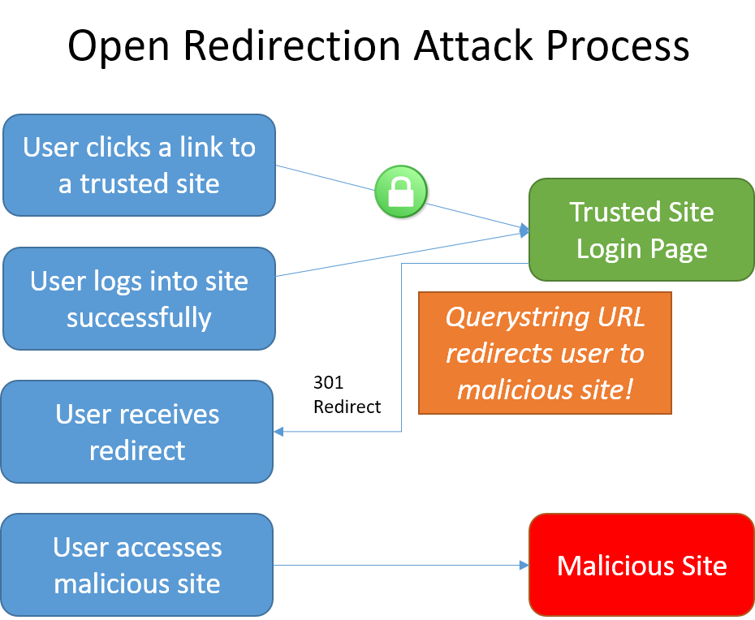

# Prevent open redirect attacks in ASP.NET Core

A web app that redirects to a URL that's specified via the request such as the query string or form data can potentially be tampered with to redirect users to an external, malicious URL. This tampering is called an open redirection attack.

Whenever your application logic redirects to a specified URL, you must verify that the redirection URL hasn't been tampered with. ASP.NET Core has built-in functionality to help protect apps from open redirect (also known as open redirection) attacks.

## What is an open redirect attack?

Web applications frequently redirect users to a login page when they access resources that require authentication. The redirection typically includes a `returnUrl` query string parameter so that the user can be returned to the originally requested URL after they have successfully logged in. After the user authenticates, they're redirected to the URL they had originally requested.

Because the destination URL is specified in the query string of the request, a malicious user could tamper with the query string. A tampered query string could allow the site to redirect the user to an external, malicious site. This technique is called an open redirect (or redirection) attack.

### An example attack

A malicious user can develop an attack intended to allow the malicious user access to a user's credentials or sensitive information. To begin the attack, the malicious user convinces the user to click a link to your site's login page with a `returnUrl` query string value added to the URL. For example, consider an app at `contoso.com` that includes a login page at `http://contoso.com/Account/LogOn?returnUrl=/Home/About`. The attack follows these steps:

1. The user clicks a malicious link to `http://contoso.com/Account/LogOn?returnUrl=http://contoso1.com/Account/LogOn` (the second URL is "contoso**1**.com", not "contoso.com").
2. The user logs in successfully.
3. The user is redirected (by the site) to `http://contoso1.com/Account/LogOn` (a malicious site that looks exactly like real site).
4. The user logs in again (giving malicious site their credentials) and is redirected back to the real site.

The user likely believes that their first attempt to log in failed and that their second attempt is successful. The user most likely remains unaware that their credentials are compromised.



In addition to login pages, some sites provide redirect pages or endpoints. Imagine your app has a page with an open redirect, `/Home/Redirect`. A cyberattacker could create, for example, a link in an email that goes to `[yoursite]/Home/Redirect?url=http://phishingsite.com/Home/Login`. A typical user will look at the URL and see it begins with your site name. Trusting that, they will click the link. The open redirect would then send the user to the phishing site, which looks identical to yours, and the user would likely login to what they believe is your site.

## Protecting against open redirect attacks

When developing web applications, treat all user-provided data as untrustworthy. If your application has functionality that redirects the user based on the contents of the URL, ensure that such redirects are only done locally within your app (or to a known URL, not any URL that may be supplied in the query string).

### LocalRedirect

:::moniker range=">= aspnetcore-6.0"

Use the <xref:Microsoft.AspNetCore.Http.Results.LocalRedirect*> result in a Minimal API endpoint:

```csharp
app.MapGet("/SomeEndpoint", (string redirectUri) =>
{
    ...
    
    return Results.LocalRedirect(redirectUri);
});
```

:::moniker-end

Use the <xref:Microsoft.AspNetCore.Mvc.ControllerBase.LocalRedirect*> helper method in MVC actions:

```csharp
public IActionResult SomeAction(string redirectUrl)
{
    return LocalRedirect(redirectUrl);
}
```

`LocalRedirect` throws an exception if a non-local URL is specified. Otherwise, it behaves just like the `Redirect` method.

### IUrlHelper.IsLocalUrl

Use the <xref:Microsoft.AspNetCore.Mvc.IUrlHelper.IsLocalUrl*> method to test URLs before redirecting:

The following example shows how to check whether a URL is local before redirecting.

```csharp
private IActionResult RedirectToLocal(string returnUrl)
{
    if (Url.IsLocalUrl(returnUrl))
    {
        return Redirect(returnUrl);
    }
    else
    {
        return RedirectToAction(nameof(HomeController.Index), "Home");
    }
}
```

The `IUrlHelper.IsLocalUrl` method protects users from being inadvertently redirected to a malicious site. You can log the details of the URL that was provided when a non-local URL is supplied in a situation where you expected a local URL. Logging redirect URLs may help in diagnosing redirection attacks.

:::moniker range=">= aspnetcore-10.0"

### Detect if URL is local using `RedirectHttpResult.IsLocalUrl`

The [`RedirectHttpResult.IsLocalUrl(url)`](https://source.dot.net/#Microsoft.AspNetCore.Http.Results/RedirectHttpResult.cs,c0ece2e6266cb369) helper method detects if a URL is local. A URL is considered local if the following are true:

* It doesn't have the [host](https://developer.mozilla.org/docs/Web/API/URL/host) or [authority](https://developer.mozilla.org/docs/Web/URI/Authority) section.
* It has an [absolute path](https://developer.mozilla.org/docs/Learn_web_development/Howto/Web_mechanics/What_is_a_URL#absolute_urls_vs._relative_urls).

URLs using [virtual paths](/previous-versions/aspnet/ms178116(v=vs.100)) `"~/"` are also local.

`IsLocalUrl` is useful for validating URLs before redirecting to them to prevent [open redirection attacks](https://brightsec.com/blog/open-redirect-vulnerabilities/).

```csharp
if (RedirectHttpResult.IsLocalUrl(url))
{
    return Results.LocalRedirect(url);
}
```

:::moniker-end

### Validate return URLs in Blazor apps

<xref:Microsoft.AspNetCore.Components.NavigationManager.NavigateTo*?displayProperty=nameWithType> doesn't check where it navigates. During static server-side rendering (static SSR), it results in a redirect to whatever URL it's given. During interactive rendering, it also follows `javascript:` URLs. Validate return URLs from the query string or form data before navigating to them.

Blazor apps usually pass return URLs as absolute URLs, such as <xref:Microsoft.AspNetCore.Components.NavigationManager.Uri?displayProperty=nameWithType>, or as paths relative to the app's base URI. `IsLocalUrl` rejects these URLs. Instead, resolve the return URL against the app's base URI and only use the result if it stays within the app. In the following example, `Navigation` is an injected <xref:Microsoft.AspNetCore.Components.NavigationManager> and `ReturnUrl` is the return URL from the query string:

```csharp
// The return URL comes from the query string, which anyone can set in a link to the app.
// To prevent open redirects, resolve it to an absolute URI and only use it if it's within the app.
// Appending "/" to the path also accepts the app's root URI without a trailing slash, such as "/app?page=2".
var baseUri = new Uri(Navigation.BaseUri);
if (!Uri.TryCreate(baseUri, ReturnUrl, out var redirectUri)
    || !(redirectUri.GetLeftPart(UriPartial.Path) + "/").StartsWith(baseUri.AbsoluteUri, StringComparison.Ordinal))
{
    redirectUri = baseUri;
}

Navigation.NavigateTo(redirectUri.AbsoluteUri);
```

Check the resolved URI rather than the original string, because string checks are easy to bypass. For example, `\/evil.example` resolves to `https://evil.example/`. Navigate to the validated absolute URI rather than its path, because the path of a URL such as `https://app.example//evil.example` is `//evil.example`, which browsers treat as a link to another host.
